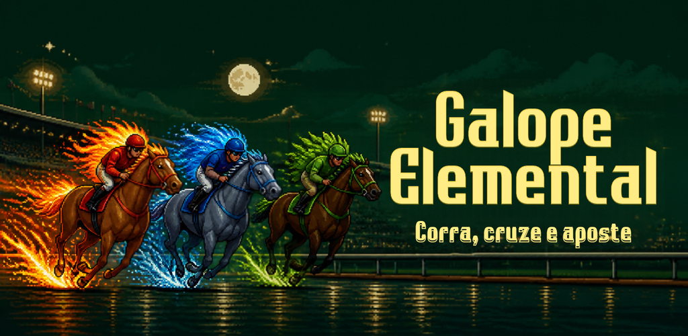

# MMORPG Horse



Jogo em pixel art de corrida de cavalos **automática** com progressão RPG, elementos
(🔥 Fogo / 💧 Água / 🌿 Grama) e PVP com apostas de moeda virtual. Alvo: web + Google Play.

**Fase atual: protótipo** — validar se corrida automática + estratégia pré-corrida + aposta é divertido.

## Onde estão as coisas

| O quê | Onde |
|---|---|
| Design (fonte da verdade) | `docs/GDD.md` |
| Wiki do jogo, gerado do código | `docs/wiki.md` |
| Medições de balanceamento | `docs/exemplos.md` |
| Estado do projeto / próximos passos | `docs/memoria/ESTADO.md` |
| Decisões e motivos | `docs/memoria/decisoes.md` |
| Registro de assets gerados (IA) | `docs/memoria/assets.md` |
| Cronograma, fases e checklist de lançamento | `docs/cronograma.md` |
| Regras de trabalho (Claude Code) | `CLAUDE.md` |
| Protótipo jogável (descartável) | `prototype/` |

## Rodar o protótipo

Sem dependências: abra `prototype/dist/preview.html` no navegador.

```bash
node prototype/build.mjs          # regenera prototype/dist/ a partir de prototype/src/
./scripts/check.sh                # verificação completa: build, todos os testes e a interface (~6 min)
```

`prototype/dist/` é **gerado e versionado** — nunca editar à mão; sempre regenerar e commitar
junto com as mudanças em `prototype/src/`. O teste de interface usa o Playwright, que precisa estar
instalado no ambiente (o projeto não tem `package.json`).
