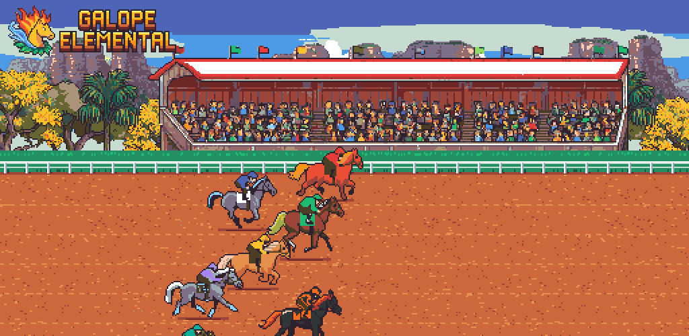

# MMORPG Horse



Jogo em pixel art de corrida de cavalos **automática** com progressão RPG, elementos
(🔥 Fogo / 💧 Água / 🌿 Grama) e PVP com apostas de moeda virtual. Alvo: web + Google Play + Steam.

**Fase atual: protótipo** — validar se corrida automática + estratégia pré-corrida + aposta é divertido.

## Onde estão as coisas

| O quê | Onde |
|---|---|
| Design (fonte da verdade) | `docs/GDD.md` |
| Wiki do jogo, gerado do código | `docs/wiki.md` |
| Medições de balanceamento | `docs/exemplos.md` |
| Estado do projeto / próximos passos | `docs/memoria/ESTADO.md` |
| Decisões e motivos | `docs/memoria/decisoes.md` |
| Registro de assets gerados (IA) | `docs/memoria/assets.md` |
| Cronograma, fases e checklist de lançamento | `docs/cronograma.md` |
| Regras de trabalho (Claude Code) | `CLAUDE.md` |
| Guias de arte e de integração visual | `docs/arte/guia.md`, `docs/arte/integracao.md` |
| Specs e planos de cada frente | `docs/superpowers/specs/`, `docs/superpowers/plans/` |
| Capturas oficiais da interface | `prototype/screens/` |
| O jogo (protótipo que virou a base, decisão de 2026-11-10) | `prototype/` |

## Rodar o protótipo

Sem dependências: abra `prototype/dist/preview.html` no navegador.

```bash
node prototype/build.mjs          # regenera prototype/dist/ a partir de prototype/src/
./scripts/check.sh                # verificação completa: build, todos os testes e a interface (~12 min)
```

`prototype/dist/` é **gerado e versionado** — nunca editar à mão; sempre regenerar e commitar
junto com as mudanças em `prototype/src/`. O teste de interface usa o Playwright, que precisa estar
instalado no ambiente (o projeto não tem `package.json`).

## Trabalhar no seu computador

1. **Baixar:** no GitHub Desktop, *File → Clone repository* → `viniciusfoliv/mmorpghorse`; ou no terminal:
   `git clone https://github.com/viniciusfoliv/mmorpghorse.git`
2. **Jogar:** abra `prototype/dist/preview.html` no navegador (`?dev=1` no fim do endereço liga o modo DEV).
   `jogo.html` é o build de produção, `jogo-dev.html` o de DEV, `jogo-teste.html` o dos testadores e `wiki.html` o wiki.
3. **Mexer:** edite `prototype/src/` e regenere com `node prototype/build.mjs` (precisa do **Node.js 22**; nada de
   `npm install`, o projeto não tem dependências).
4. **Conferir:** `./scripts/check.sh` (no Windows, pelo Git Bash ou pelo WSL). O teste de interface precisa do
   Playwright com o Chromium instalados à parte.
5. **Enviar:** commit + push num branch próprio (`feat/...`). Os chats na nuvem só enxergam o que está no GitHub, então
   puxe (*Pull*) antes de começar e envie (*Push*) ao terminar.

**Segredos:** chaves (PixelLab, Meshy, Gemini) nunca entram no código nem nos commits — ficam em variáveis de ambiente
ou nas configurações do ambiente da nuvem (no seu computador, `PIXELLAB_API_KEY` para os scripts do PixelLab). Os
scripts que gastam créditos rodam em dry-run por padrão.
