# Wiki do Galope Elemental

> Gerado de `prototype/src/` por `prototype/tools/wiki.mjs` (dados `0.2-prototipo`). Não edite à mão: rode `node prototype/build.mjs`. Versão com retratos e busca: `prototype/dist/wiki.html`.

## Seções

- [Visão geral](#visao)
- [Status](#status)
- [Level e XP](#level)
- [Raridades](#raridades)
- [Elementos e clima](#elementos)
- [Skills](#skills)
- [Dado da Sorte](#dado)
- [Pista e simulação](#pista)
- [Montarias](#montarias)
- [Marcas e jóquei](#marcas)
- [Portes](#portes)
- [Cruzamento (Haras)](#cruzamento)
- [Equipamento](#equipamento)
- [Economia](#economia)
- [Itens e recompensa diária](#itens)
- [Ginásios da Expedição](#ginasios)
- [Corrida AFK](#afk)
- [Ícones reservados](#icones-reservados)
- [Modo DEV](#dev)

<a id="visao"></a>

## Visão geral

**Galope Elemental** é um jogo de corrida de cavalos automática em pixel art. Você não controla o cavalo durante a corrida: decide antes (montaria e entrada) e assiste. Os cavalos têm tipo (Fogo, Água e Grama), raridade, estrelas, genética, level e skills; nada cresce sozinho: cada level dá pontos para o jogador comprar status.

### Ciclo de uma corrida

1. **Escolher a montaria.** No começo você escolhe uma das 3 iniciais (Brasa, Maré e Ipê) e recebe 500 de Ouro e o equipamento inicial (Sela de Couro Cru e Ferradura Leve, já equipado).
2. **Procurar sala.** Na aba Correr você escolhe a entrada (50, 100 ou 250 de Ouro). A sala tem de 4 a 8 corredores: você e bots com Poder perto do seu. Pista, clima e rivais saem da seed da sala e não mudam até você correr.
3. **Pagar a entrada.** Só depois de "Largar!" a corrida é simulada; o resultado nunca é calculado antes.
4. **Corrida automática.** O jóquei dosa o ritmo pela estamina; skills disparam nos gatilhos; o Dado da Sorte rola em 1/3 e 2/3 da pista e pode virar o clima; a Garra decide a reta final.
5. **Prêmio e XP.** A casa fica com 10% do pote e o resto vai para os primeiros colocados. Todos ganham XP pela colocação. No pódio de corrida valendo pode cair um Pergaminho de técnica (ver Skills, Rank das skills).

### Abas do jogo

- **Estábulo:** o cartão da recompensa do dia, no topo; suas montarias (2 vagas no começo, até 5), status, skills (com o rank de cada uma) e equipamento; escolher a ativa.
- **Correr:** escolher a entrada (50, 100 ou 250 de Ouro) e procurar corrida; sem Ouro para a menor entrada, treino gratuito.
- **Expedição:** os 3 ginásios (Ginásio da Grama, Ginásio da Água e Ginásio do Fogo), cada um com quantas etapas já venceu ("N de 5 vencidos"), a insígnia conquistada e "Revanche hoje" quando a revanche do líder está livre (o ponto na aba avisa) ou "Revanche amanhã" depois de tentada a de hoje. Em cima, o mapa da ilha com os três ginásios no lugar deles, vivo (água, lava, nuvens, fumaça do vulcão), com névoa sobre o que ainda não tem a insígnia (só visual) e, em cada ginásio, o estandarte do líder, as etapas vencidas, a insígnia e "!" na revanche livre; tocar num ginásio do mapa é o mesmo que tocar no cartão dele, e a ida e a volta são uma viagem curta (aproximação e íris; direta com movimento reduzido). Tocar no ginásio abre a trilha: as 5 etapas de baixo para cima (Soldado 1, Soldado 2, Soldado 3, Soldado 4 e o Líder), cada uma vencida, próxima (a única que se toca) ou fechada ("Vença a etapa anterior"), e o ponto fraco escrito ("Ponto fraco: Fogo vence Grama"); ao abrir, a trilha rola o mínimo para a etapa que se pode tocar aparecer inteira. No mapa da trilha, a pista de terra está pintada até a etapa da vez e o seu cavalo ativo espera ao lado dela; depois de uma vitória, ao voltar para a trilha, a pista se pinta até a etapa nova e o cavalo trota até lá. **Preparo:** a etapa próxima mostra os cavalos do adversário (nível, estrelas, elemento e Poder), a pista da casa, a entrada e o prêmio da 1ª vitória; em "Seu time" você toca nos seus cavalos na ordem em que vão correr, até o tamanho do time do adversário (tocar de novo tira). Cada linha diz "Vantagem" ou "Desvantagem" contra o elemento do ginásio; com uma sala de corrida aberta (valendo ou treino), o cavalo ativo fica de fora, com o motivo escrito. **Pagar:** "Desafiar (N de Ouro)" cobra a entrada e só então o desafio é simulado; sem time, sem Ouro (o reservado para a sala aberta não conta) ou com a mochila cheia do item do prêmio, o botão fica apagado com o motivo. **Duelos:** cada duelo passa na tela de corrida, com 2 raias: a placa diz "Duelo N" (nunca quantos serão), e uma linha diz a vantagem de elemento e o fôlego de quem larga cansado; "Pular" termina o duelo (depois da chegada ele diz "Continuar") e "Pular tudo" vai direto ao resumo. Entre um duelo e outro, um cartão diz como foi o seu cavalo e por quantos metros, quem saiu e quem entra, a faixa do cansaço com o fôlego de quem ficou ("Vitória apertada (menos de 1 m): … larga com 75% do fôlego") e a vantagem do próximo duelo, com "Próximo duelo" e "Pular tudo". Os metros são truncados para baixo (7,6 m aparece como 7 m); abaixo de 1 m, "menos de 1 m". **Resumo:** cada duelo com "Você venceu" ou "Você perdeu", os metros e o fôlego de quem seguiu; a entrada, o prêmio e os itens; o XP de cada cavalo (os níveis e as skills que aprendeu, ou "não correu"); a insígnia e a etapa liberada. Perdendo, "Tentar de novo" volta ao preparo com o mesmo time; sempre há "Voltar à trilha". **Revanche:** depois da insígnia, a etapa do líder vira a revanche, uma vez por dia: "Revanche hoje", com a entrada de 50 de Ouro e o prêmio de hoje do rodízio; tentada a de hoje, a etapa diz "Feita hoje" e "Revanche de hoje feita. Volte amanhã.", e a revanche perdida não tem "Tentar de novo". **Treino AFK:** na trilha, cada oponente já vencido tem "Treinar (AFK)", que abre a escolha do treino (oponente, dificuldade, vaga e cavalo). O cartão "Treino AFK" da aba abre as vagas (o cavalo, o oponente, a chance de vitória medida, a corrida em curso e a última; Assistir, Trocar e Tirar; "Abrir vaga" com o preço) e o baú ("Coletar tudo"); o cartão "Bestiário" abre as páginas dos ginásios (ver Corrida AFK). Embaixo, o bloco recolhido "Cavalos selvagens", com o selo "em breve": a captura ainda não existe no protótipo (6 selvagens já estão separados para a vitrine dela).
- **Haras:** cruzar com um reprodutor de aluguel ou com outra montaria sua, ou fazer a Troca.
- **Loja:** em **Comprar**, os itens de uso (Torrão de açúcar, Manual de doma, Cupom de troca de skill e Estrela de treino) com Ouro, um toque por compra, dentro do limite do dia; em **Mochila**, os 6 itens, quantos você tem de cada e o botão Usar (o Pergaminho de técnica não tem Usar: é gasto ao subir rank, na aba Skills do cavalo) e, embaixo, os itens do treino AFK por grupo (comidas, com o Usar e a escolha do cavalo; materiais; Pergaminho de reforja; troféus); também peças de equipamento (menos as de raridade Lendário) e Pedras Negras.
- **Perfil (o botão do cabeçalho):** as estatísticas (corridas, vitórias, pódios e prêmios), o Ouro e quantas montarias você tem; as insígnias dos ginásios ("Insígnias (N de 3)", as 3 na ordem Insígnia da Grama, Insígnia da Água e Insígnia do Fogo: a conquistada com o ícone, o nome e o bônus; a que falta apagada, com "Vença o líder do …"); o seu jóquei (seda e capacete); as animações; e "Recomeçar com outro inicial".

> Ainda não existem no protótipo: Gemas, passe, ovos, contas, servidor, as expedições fora os ginásios e a captura. A única moeda é o Ouro; as Pedras Negras são material de melhoria.

Versão dos dados: `0.2-prototipo`. Este wiki é gerado do código (`prototype/src/`) por `prototype/tools/wiki.mjs`; não edite à mão.

<a id="status"></a>

## Status

Cada montaria tem 7 status na escala de 1 a 150. Na corrida o motor usa n(x) = status / 100, e toda fórmula da corrida rende em linha reta até 150. O valor é arredondado uma vez só, no fim, e preso entre 1 e 150.

| Sigla | Status | Descrição no jogo | Na corrida |
| ---: | --- | --- | --- |
| VEL |  Velocidade | Velocidade máxima nas retas. É o status que mais pesa numa reta longa. | Velocidade máxima: vMax = 19 + 1,13 × n(VEL) m/s (VEL 50 → 19,57 m/s; VEL 100 → 20,13 m/s; VEL 150 → 20,7 m/s). Ritmo, piso, bloco e boosts multiplicam esse teto. |
| ACE |  Aceleração | Quão rápido chega à velocidade máxima na largada e depois de perder ritmo. | Aceleração = 1 / max(0,044, 1,158 − 0,66 × n(ACE)) m/s² (ACE 50 → 1,21; ACE 100 → 2,01; ACE 150 → 5,95): cada ponto encurta a largada igual. Vale na largada e nas retomadas (saída de curva e de subida). Também encurta a reação à largada: atraso sorteado de até 0,56 s × (1 − 0,333 × min(n(ACE), 1,5)). |
| MAN |  Manobra | Rendimento nas curvas: quem tem mais perde menos velocidade nelas. | Fator da curva = min(1, 0,704 + 0,185 × n(MAN)): de 79,7% (MAN 50) a 98,2% (MAN 150) da velocidade dentro da curva. |
| FOR | 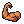 Força | Rendimento nas subidas, nos pisos pesados e para passar pelo pelotão. | Fator da subida = min(1, 0,824 + 0,11 × n(FOR)): de 87,9% (FOR 50) a 98,9% (FOR 150). Alivia o piso pesado (20% × n(FOR) da perda), o aperto do pelotão (60% × n(FOR), até zerar) e o gasto extra da subida (+30% × (1 − 0,5 × n(FOR))). |
| EST |  Estamina | Fôlego para manter o ritmo até o fim; também deixa correr mais forte no meio e no sprint. | Tanque = 66 + 20 × n(EST) (EST 50 → 76). Também sobe o teto do ritmo: + 3,5% × (n(EST) − 0,5) no meio e + 6,5% × (n(EST) − 0,5) no sprint final, então rende mesmo com tanque de sobra. O clima não mexe na Estamina. |
| GAR |  Garra | Força média da arrancada final, que acontece sempre; com mais Garra ela começa mais cedo e empurra mais. | A arrancada começa em 80% − 14% × (n(GAR) − 0,5) da pista (GAR 50 → 80%; GAR 100 → 73%). Lá ela acontece **sempre**. A força média é F = 0 + 0,19 × n(GAR); a de cada corrida vai de 0% a 200% dela, pela seed, e o teto de velocidade vai a ×(1 + força) até a chegada. Mais Garra: começa antes e empurra mais. |
| SOR |  Sorte | Vem do nascimento e não recebe pontos. Chance de jogar o Dado da Sorte duas vezes. | Vem do nascimento: não recebe pontos. No Dado da Sorte, a chance de rolar um 2º dado é (SOR − 40) / 40, presa entre 0% e 100% (SOR 40 → 0%; SOR 80 → 100%). Fora da corrida, a **genética** de Sorte melhora a cruza e o drop raro do treino AFK (ver Cruzamento e Treino AFK). Não entra no Poder, e as skills ativam sempre, sem sorteio. |

### Explicações do botão ⓘ

No jogo, o botão ⓘ ao lado de cada rótulo mostra estas frases (no computador, com o mouse; no toque, abrindo e fechando embaixo do rótulo). Os sete status têm a frase na tabela acima.

| Rótulo | Texto |
| ---: | --- |
| Nota de genética | Nota S, A, B ou C: o quanto o status já nasce alto. Vem do nascimento e não muda. |
| Estrelas | Grau do cavalo, de 1 a 3 estrelas: mais estrelas, mais pontos para distribuir a cada nível. |
| Raridade | Quanto mais rara, mais pontos por nível, mais vagas de skill e status que já nascem mais altos. |
| Skill de tipo | Uma por elemento, sempre ativa num terço da pista: os dois status do tipo valem mais naquele trecho. |
| Poder | Nota da força geral do cavalo, calculada dos status, das skills, do nível e da raridade. Define a liga e os rivais da sala. |
| Liga | Faixa do Poder, para comparar cavalos. Os rivais da sala vêm do seu Poder, não da liga. |
| Clima | Cada elemento rende mais no seu clima e menos no clima ruim. O Dado da Sorte pode virar o clima na corrida. |
| Piso | Piso mais pesado tira velocidade e gasta mais fôlego; a Força ajuda a perder menos. |
| Dado da Sorte | Duas vezes por corrida, quem tira o maior dado puxa o clima para o seu elemento. Sorte alta rola dois dados. |
| Custo dos pontos | O custo de cada ponto sobe a cada 10 pontos comprados no mesmo status. Os pontos que sobram ficam guardados para depois. |
| Rédea nova | Devolve todos os pontos para você distribuir de novo. A primeira de cada cavalo é grátis; depois gasta 1 Rédea nova. |
| Rank das skills | Skill de vaga ativa sempre. O rank (I a V) dá +15% de efeito por passo e, no V, um marco. Sobe com Ouro e Pergaminhos de técnica, sem falhar e sem volta. |

### Como o status é calculado

```text
base   = início da faixa da raridade + 16 × g / 31      (nada cresce sozinho com o level)
status = base + pontos comprados, arredondado e preso entre 1 e 150
pontos(L) = piso(fator da raridade × fator das estrelas × [(L − 1) × 2 + 4 × (L − 1)(L − 2) / 96]) + torrões
custo do i-ésimo ponto num mesmo status (i = 0, 1, …) = 1 + piso(i / 10)
```

- **Genética (g):** de 0 a 31 por status, só do nascimento. Define onde o status nasce dentro da faixa da raridade (16 pontos de largura). Nota da genética no jogo: C 0–7 · B 8–15 · A 16–23 · S 24–31.
- **Pontos por level:** a taxa sobe em linha reta de 2 pontos no Nv 2 a 6 no Nv 50 (antes dos fatores de raridade e estrelas; ver Level e XP, Raridades e Estrelas). O jogador compra status com eles na aba Status e confirma.
- **Custo por faixa:** os 10 primeiros pontos num status custam 1 cada, os 10 seguintes 2, depois 3, e assim por diante. A genética não entra no custo. Por isso pôr tudo num status só rende pouco.
- **Torrões:** cada Torrão de açúcar usado no cavalo é 1 ponto a mais, somado depois do piso; até 10 por cavalo (ver Itens).
- **Teto:** base + pontos ≤ 150 em cada status. Ninguém chega lá: o pior caso (Mítico ★★★ no Nv 50, genética 31, com os 10 torrões e todos os pontos num status) fica em 148.
- **Sorte:** só de nascimento, não recebe pontos: fica na base, de 40 (Comum, genética 0) a 76 (Mítico, genética 31).
- **Equipamento:** só vale no treino AFK; na corrida valendo e no Poder as peças não mexem nos status (ver Equipamento).

**Custo dos pontos num mesmo status**

| Pontos no status | Custo de cada ponto da faixa | Custo total até o fim da faixa |
| ---: | ---: | ---: |
| 1º a 10º | 1 | 10 |
| 11º a 20º | 2 | 30 |
| 21º a 30º | 3 | 60 |
| 31º a 40º | 4 | 100 |
| 41º a 50º | 5 | 150 |
| 51º a 60º | 6 | 210 |
| 61º a 70º | 7 | 280 |
| 71º a 80º | 8 | 360 |

O clima também mexe nos status durante a corrida: soma (m − 1) × 0,5 a n(x) de VEL, ACE, MAN, FOR e GAR, com o multiplicador m do clima (ver Elementos e clima), o mesmo efeito em qualquer nível. Não mexe em EST nem em SOR.

<a id="level"></a>

## Level e XP

Level máximo: **50**. Para subir do level L para L + 1 são 50 + 25 × L de XP. Do level 1 ao 50 são 33.075 de XP no total. No level máximo o XP ainda acumula até 1.300 (o valor de um level 50 → 51) e aí trava.

### XP por colocação e treino

| Colocação | XP (corrida valendo) | XP (treino) | Ouro do treino |
| --- | ---: | ---: | --- |
| 1º | 100 | 50 | 30 |
| 2º | 70 | 35 | 22 |
| 3º | 50 | 25 | 16 |
| 4º | 35 | 18 | 12 |
| 5º | 25 | 13 | 10 |
| 6º | 20 | 10 | 10 |
| 7º | 15 | 8 | 10 |
| 8º | 10 | 5 | 10 |

**Treino gratuito:** aparece quando seu Ouro não cobre a menor entrada (50). Não cobra entrada, rende 1/2 do XP e de 10 a 30 de Ouro pela colocação, e não dá Pedra Negra nem Pergaminho de técnica.

**Duelos de ginásio:** cada cavalo do time ganha 50 de XP por duelo vencido e 15 por duelo perdido (ver Ginásios da Expedição). Com a Insígnia da Água, todo XP somado a um cavalo (corridas, treino e duelos) ganha +3%, arredondado.

### XP necessário por level

| Level | XP | Acumulado |
| --- | ---: | ---: |
| Nv 1 → 2 | 75 | 75 |
| Nv 2 → 3 | 100 | 175 |
| Nv 3 → 4 | 125 | 300 |
| Nv 4 → 5 | 150 | 450 |
| Nv 5 → 6 | 175 | 625 |
| Nv 6 → 7 | 200 | 825 |
| Nv 7 → 8 | 225 | 1.050 |
| Nv 8 → 9 | 250 | 1.300 |
| Nv 9 → 10 | 275 | 1.575 |
| Nv 10 → 11 | 300 | 1.875 |
| Nv 11 → 12 | 325 | 2.200 |
| Nv 12 → 13 | 350 | 2.550 |
| Nv 13 → 14 | 375 | 2.925 |
| Nv 14 → 15 | 400 | 3.325 |
| Nv 15 → 16 | 425 | 3.750 |
| Nv 16 → 17 | 450 | 4.200 |
| Nv 17 → 18 | 475 | 4.675 |
| Nv 18 → 19 | 500 | 5.175 |
| Nv 19 → 20 | 525 | 5.700 |
| Nv 20 → 21 | 550 | 6.250 |
| Nv 21 → 22 | 575 | 6.825 |
| Nv 22 → 23 | 600 | 7.425 |
| Nv 23 → 24 | 625 | 8.050 |
| Nv 24 → 25 | 650 | 8.700 |
| Nv 25 → 26 | 675 | 9.375 |
| Nv 26 → 27 | 700 | 10.075 |
| Nv 27 → 28 | 725 | 10.800 |
| Nv 28 → 29 | 750 | 11.550 |
| Nv 29 → 30 | 775 | 12.325 |
| Nv 30 → 31 | 800 | 13.125 |
| Nv 31 → 32 | 825 | 13.950 |
| Nv 32 → 33 | 850 | 14.800 |
| Nv 33 → 34 | 875 | 15.675 |
| Nv 34 → 35 | 900 | 16.575 |
| Nv 35 → 36 | 925 | 17.500 |
| Nv 36 → 37 | 950 | 18.450 |
| Nv 37 → 38 | 975 | 19.425 |
| Nv 38 → 39 | 1.000 | 20.425 |
| Nv 39 → 40 | 1.025 | 21.450 |
| Nv 40 → 41 | 1.050 | 22.500 |
| Nv 41 → 42 | 1.075 | 23.575 |
| Nv 42 → 43 | 1.100 | 24.675 |
| Nv 43 → 44 | 1.125 | 25.800 |
| Nv 44 → 45 | 1.150 | 26.950 |
| Nv 45 → 46 | 1.175 | 28.125 |
| Nv 46 → 47 | 1.200 | 29.325 |
| Nv 47 → 48 | 1.225 | 30.550 |
| Nv 48 → 49 | 1.250 | 31.800 |
| Nv 49 → 50 | 1.275 | 33.075 |

### Pontos por level

Nenhum status cresce sozinho: cada level dá pontos para comprar status (ver Status). A taxa sobe de 2 no Nv 2 a 6 no Nv 50, vezes o fator da raridade e o das estrelas, então dez levels rendem parecido em qualquer ponto da progressão.

**Pontos acumulados por level (★★)**

| Level | Comum | Mágico | Raro | Lendário | Mítico |
| ---: | ---: | ---: | ---: | ---: | ---: |
| Nv 2 | 2 | 2 | 2 | 2 | 2 |
| Nv 5 | 9 | 9 | 10 | 10 | 11 |
| Nv 11 | 25 | 27 | 28 | 29 | 31 |
| Nv 20 | 56 | 59 | 62 | 65 | 68 |
| Nv 30 | 100 | 105 | 110 | 115 | 120 |
| Nv 40 | 152 | 159 | 167 | 175 | 182 |
| Nv 50 | 213 | 224 | 235 | 245 | 256 |

**Pontos acumulados, Comum / Mítico**

| Estrelas | Nv 11 | Nv 30 | Nv 50 |
| ---: | ---: | ---: | ---: |
| ★ | 23 / 28 | 91 / 110 | 196 / 235 |
| ★★ | 25 / 31 | 100 / 120 | 213 / 256 |
| ★★★ | 28 / 34 | 112 / 134 | 239 / 286 |

Exemplo: Brasa (Comum ★★) no Nv 50 tem 213 pontos. Com a build dos bots (a mesma do "Distribuir sugerido") fica com VEL 77, ACE 77, MAN 68, FOR 66, EST 66, GAR 67. Pondo tudo em Velocidade (genética 24), ela chegaria a 112, e os outros ficariam na base.

### Aprender skill ao subir de level

A cada level ganho há 8% de chance de aprender uma skill nova (11% com a Insígnia da Grama, ver Ginásios; sorteio pela seed do save). Só entra se houver vaga (vagas da raridade) e a skill sorteada é uma das que a montaria pode ter: geral ou do próprio elemento, nunca repetida. A skill aprendida entra no rank I (ver Skills, Rank das skills).

### Exemplo: as iniciais por level (build dos bots)

| Montaria | Level | VEL | ACE | MAN | FOR | EST | GAR | SOR | Poder | Liga |
| --- | ---: | ---: | ---: | ---: | ---: | ---: | ---: | ---: | ---: | --- |
| Brasa | 1 | 52 | 52 | 47 | 46 | 46 | 47 | 46 | 629 | Bronze |
| Brasa | 10 | 56 | 56 | 51 | 50 | 49 | 50 | 46 | 680 | Bronze |
| Brasa | 25 | 65 | 65 | 58 | 57 | 56 | 57 | 46 | 787 | Prata |
| Brasa | 50 | 77 | 77 | 68 | 66 | 66 | 67 | 46 | 933 | Platina |
| Maré | 1 | 47 | 46 | 46 | 47 | 52 | 52 | 46 | 626 | Bronze |
| Maré | 10 | 51 | 50 | 49 | 50 | 56 | 56 | 46 | 677 | Bronze |
| Maré | 25 | 58 | 57 | 56 | 57 | 65 | 65 | 46 | 782 | Prata |
| Maré | 50 | 68 | 66 | 66 | 67 | 77 | 77 | 46 | 928 | Platina |
| Ipê | 1 | 48 | 46 | 52 | 52 | 47 | 46 | 45 | 633 | Bronze |
| Ipê | 10 | 52 | 50 | 56 | 56 | 50 | 49 | 45 | 685 | Bronze |
| Ipê | 25 | 59 | 57 | 65 | 65 | 57 | 56 | 45 | 791 | Prata |
| Ipê | 50 | 69 | 66 | 77 | 77 | 67 | 66 | 45 | 938 | Platina |

<a id="raridades"></a>

## Raridades

São 5 raridades, da mais comum à mais rara: Comum, Mágico, Raro, Lendário e Mítico. A raridade define a faixa onde o status nasce (pela genética), o fator dos pontos por level, as vagas de skill e a força da skill de tipo (ver Skills). Só muda por cruzamento. O teto é o mesmo para todas: 150.

| Raridade | Cor | Status nasce entre | Fator dos pontos | Pontos no Nv 50 (★★) | Vagas de skill (além da de tipo) | Skills do potro (mínimo) | Preço da peça | Aluguel base | Montarias no jogo |
| --- | --- | ---: | ---: | ---: | ---: | ---: | --- | --- | ---: |
| 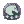 Comum | #9e9e9e | 40–56 | ×1 | 213 | 1 | 1 | 100 | 100 | 6 |
| 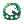 Mágico | #4caf50 | 44–60 | ×1,05 | 224 | 2 | 1 | 250 | 250 | 3 |
| 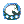 Raro | #2196f3 | 49–65 | ×1,1 | 235 | 3 | 2 | 600 | 600 | 2 |
| 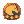 Lendário | #ff9800 | 54–70 | ×1,15 | 245 | 4 | 2 | 1.500 | 1.500 | 2 |
| 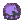 Mítico | #9c27b0 | 60–76 | ×1,2 | 256 | 5 | 3 | não existe | não se aluga | 2 |

Raridade mais alta que nasce de cruzamento: **Lendário**. Mítico nunca nasce de cruzamento e não se aluga.

### Estrelas

Cada montaria tem de ★ a ★★★. As estrelas multiplicam os pontos ganhos por level e mudam o preço do aluguel; não mexem na genética. O potro recebe as estrelas no nascimento (ver Cruzamento); as iniciais e os selvagens têm as estrelas definidas nos dados. A Estrela de treino sobe 1 estrela (ver Itens e recompensa diária).

| Estrelas | Fator dos pontos | Pontos no Nv 50 (Comum) | Multiplicador do aluguel |
| ---: | ---: | ---: | ---: |
| ★ | ×1 | 196 | ×1 |
| ★★ | ×1,09 | 213 | ×1,25 |
| ★★★ | ×1,22 | 239 | ×1,5 |

### Corcel

Uma montaria é **Corcel** quando já tem todas as skills "de linha" da sua raridade. Corcel garante herança de skill no cruzamento (ver Cruzamento).

| Raridade | Skills de linha |
| --- | --- |
| Comum | Arranque |
| Mágico | Arranque, Sprint |
| Raro | Arranque, Sprint, Drift |
| Lendário | Arranque, Sprint, Drift, Saída Rápida |
| Mítico | Arranque, Sprint, Drift, Saída Rápida, Arrancada Final |

<a id="elementos"></a>

## Elementos e clima

São 3 tipos (elementos). Cada um tem a sua skill de tipo, sempre ativa num terço da pista (ver Skills), e um clima "dono", que o favorece. Cada clima também penaliza um tipo. Fora do clima e da skill, o tipo não mexe nos status.

| Elemento | Clima dono | Penalizado por | Descrição |
| --- | --- | --- | --- |
| Fogo | Sol | Chuva | Explosivo na largada: a Labareda acelera o primeiro terço. Brilha no sol; sofre com chuva. |
| Água | Chuva | Névoa | Forte no fim: a Maré Alta empurra o último terço. Cresce na chuva; sofre na névoa. |
| Grama | Névoa | Sol | Firme como raiz: as Raízes Firmes seguram o terço do meio. Domina a névoa; murcha no sol. |

### Climas

| Clima | Favorece | Penaliza | Efeito geral | Descrição |
| --- | --- | --- | --- | --- |
|  Sol | Fogo | Grama | gasto de estamina ×1,04 para todos | Favorece Fogo; Grama murcha. |
| 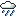 Chuva | Água | Fogo | velocidade −1,5% para todos | Favorece Água; Fogo apaga. |
|  Névoa | Grama | Água | nenhum efeito geral | Favorece Grama; Água perde o rumo. |
|  Nublado | — | — | nenhum efeito geral | Condição neutra: ninguém é favorecido. |

### Multiplicador de clima (m)

Elemento dono do clima: ×1,03; com a skill de clima ativa (Sol a Pino, Pé na Chuva e Névoa Amiga), de ×1,07 no rank I a ×1,094 no rank V (ver Skills, Rank das skills). Elemento penalizado: ×0,97. O resto, e todos no Nublado, ×1. O multiplicador **não multiplica o status**: entra somado a n(x): nc(x) = n(x) + (m − 1) × 0,5, ou seja **+1,5 em cada status** para o dono do clima (−1,5 para o penalizado), o mesmo efeito em qualquer nível.

| Elemento | Sol | Chuva | Névoa | Nublado |
| --- | ---: | ---: | ---: | ---: |
| Fogo | ×1,03 | ×0,97 | ×1,00 | ×1,00 |
| Água | ×1,00 | ×1,03 | ×0,97 | ×1,00 |
| Grama | ×0,97 | ×1,00 | ×1,03 | ×1,00 |

```text
nc(x)      = n(x) + (m − 1) × 0,5
vMax       = (19 + 1,13 × nc(VEL)) × (1 + 0,1 × (m − 1))
aceleração = 1 / max(0,044, 1,158 − 0,66 × nc(ACE))
Força, Manobra e Garra efetivas = nc(x)
```

O clima inicial sai da seed da sala. O Dado da Sorte pode virar o clima no meio da corrida (ver Dado da Sorte); quando vira, os números de todos são recalculados (o que já foi gasto não volta).

### Vento (só visual)

Cada sala tem um vento sorteado pela seed: calmo 35%, brisa 40% e ventania 25%, soprando para a direita ou para a esquerda. Ele só mexe no desenho (bandeirinhas, folhas, nuvens, inclinação da chuva); não entra na simulação.

<a id="skills"></a>

## Skills

Toda montaria tem a **skill de tipo** do seu elemento, em vaga própria e sempre ativa (abaixo). Além dela, há 15 skills de vaga normal. Cada uma tem um gatilho; quando ele acontece, a skill **ativa sempre**, sem sorteio (uma vez por corrida, ou uma vez por bloco nas skills de curva e subida marcadas "em cada bloco"), e o efeito vale pelo tempo ou pela distância indicados. Raridade, level e Sorte não mudam a ativação. Cada skill de vaga tem um **rank**, de I a V, por cavalo, que aumenta o efeito (ver Rank das skills, abaixo).

**Skills de largada** disparam no sinal (t = 0), antes do atraso de reação do cavalo (até 0,56 s, menor com ACE alta). A duração conta desde o sinal, então esse atraso consome parte dela.

### Skill de tipo

Sem sorteio e sem chance: age sempre, no terço da distância que é do tipo (o terço é proporcional à distância da pista). No terço, os **dois status do tipo** valem × (1 + m × P): quem investe neles ganha mais. O m de cada skill está abaixo; P é a força, que varia com o level e a raridade de um jeito próprio de cada tipo. No início do terço aparece o balão da skill.

```text
P = 1 + nívelT × (level − 1) / 49 + raridadeT × ordem da raridade / 4      (ordem: Comum 0, Mágico 1, Raro 2, Lendário 3, Mítico 4)
```

| Skill | Tipo | Terço | Efeito (P = 1) | nívelT | raridadeT | Lendário Nv 50 | Balão |
| --- | --- | --- | --- | ---: | ---: | --- | --- |
|  **Labareda** | Fogo | primeiro terço (da largada a 1/3) | Velocidade e Aceleração ×1,19 (+19%) | −0,15 | 0,15 | P = 0,962: Velocidade e Aceleração ×1,183 (+18,3%) | LABAREDA |
|  **Maré Alta** | Água | último terço (de 2/3 à chegada) | Estamina e Garra ×1,33 (+33%) | 0 | 0,15 | P = 1,113: Estamina e Garra ×1,367 (+36,7%) | MARÉ ALTA |
| 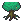 **Raízes Firmes** | Grama | terço do meio (de 1/3 a 2/3) | Força e Manobra ×1,15 (+15%) | 0,25 | 0,4 | P = 1,55: Força e Manobra ×1,233 (+23,3%) | RAÍZES FIRM. |

**Força P por raridade (Nv 1 → Nv 50)**

| Raridade | Labareda | Maré Alta | Raízes Firmes |
| --- | ---: | ---: | ---: |
| Comum | 1 → 0,85 | 1 → 1 | 1 → 1,25 |
| Mágico | 1,038 → 0,888 | 1,038 → 1,038 | 1,1 → 1,35 |
| Raro | 1,075 → 0,925 | 1,075 → 1,075 | 1,2 → 1,45 |
| Lendário | 1,113 → 0,962 | 1,113 → 1,113 | 1,3 → 1,55 |
| Mítico | 1,15 → 1 | 1,15 → 1,15 | 1,4 → 1,65 |

Exemplo com P = 1: na Labareda, Velocidade 60 vale 71,4 no terço; com 100, vale 119. A Maré Alta multiplica a Estamina só no teto do ritmo (o tanque não muda). Elemento sem skill de tipo corre sem ela. A skill de tipo não troca, não conta nas vagas e não entra no Poder (lá, level e raridade valem o mesmo para os três tipos).

### Rank das skills

Cada skill de vaga de cada cavalo tem um rank, de I a V (a skill de tipo não tem rank). O rank é do cavalo, não da conta: a mesma skill pode estar no rank I num cavalo e no V em outro. A skill ativa sempre em qualquer rank; o que muda é a força. O fator do rank r é s(r) = 1 + 0,15 × (r − 1), e ele age **só na parte de bônus** do efeito do rank I (tabela "Skills de vaga", abaixo). No rank V a skill ganha também o **marco**, um efeito próprio somado ao que já foi escalado.

**Fator do rank**

| Rank | Fator s | A mais que o rank I |
| ---: | ---: | ---: |
| I | ×1,00 | — |
| II | ×1,15 | +15% |
| III | ×1,30 | +30% |
| IV | ×1,45 | +45% |
| V | ×1,60 | +60% |

Como o fator entra em cada formato de efeito (os exemplos do último rank são antes do marco):

- **Multiplicador que ajuda** (aceleração e velocidade), m no rank I: 1 + (m − 1) × s. Exemplo: aceleração de Arranque, ×1,108 no rank I e ×1,173 no rank V.
- **Multiplicador que reduz gasto** (gasto extra da subida e gasto de estamina), m no rank I: 1 − (1 − m) × s, nunca abaixo de ×0,05. Exemplo: gasto de estamina de Canto da Iara, ×0,8 no rank I e ×0,68 no rank V. Bate no piso: Fôlego de Montanha (gasto extra da subida) a partir do rank IV.
- **Bônus somado** (fator da curva, impulso da Garra e fator da subida), b no rank I: b × s. Exemplo: fator da curva de Drift, +1,3% no rank I e +2,08% no rank V.
- **Recuperação** (recuperação de estamina), x no rank I: x × s. Exemplo: recuperação de estamina de Segundo Ar, 10% no rank I e 16% no rank V.
- **Reforço de clima** (Sol a Pino, Pé na Chuva e Névoa Amiga), b no rank I: o bônus do dono do clima passa de ×1,03 para ×(1,03 + b × s): ×1,07 · ×1,076 · ×1,082 · ×1,088 · ×1,094 do rank I ao V.
- **Dado extra** (Dado Viciado): fora da escala. O dado extra rola de 1 até o teto do rank: 60 · 70 · 80 · 90 · 100 do rank I ao V (ver Dado da Sorte).
- **Duração e distância** não crescem com o rank, nem o "em cada bloco" das skills de curva e subida (só o marco do rank V muda a duração, quando ele diz).

#### Custo para subir

Sobe-se um rank por vez, na ficha do cavalo, aba Skills, no botão **Subir rank** de cada skill: paga-se Ouro e Pergaminhos de técnica. Não há sorteio: a subida nunca falha, e não tem volta. O Ouro guardado para a entrada do páreo aberto não entra na conta. Com o páreo aberto (valendo ou treino), **o cavalo ativo não sobe rank**, porque o Poder dele não pode passar do que a sala viu; os outros cavalos sobem. O botão apagado diz o motivo: falta Ouro, faltam Pergaminhos, rank máximo ou páreo aberto.

**Custo para subir o rank de uma skill**

| Passo | Ouro | Pergaminhos de técnica |
| ---: | --- | ---: |
| I → II | 150 | 1 |
| II → III | 400 | 2 |
| III → IV | 900 | 4 |
| IV → V | 2.000 | 7 |
| **Total (I → V)** | 3.450 | 14 |

Um cavalo Mítico com as 5 vagas no rank V custa 17.250 de Ouro e 70 Pergaminhos de técnica.

#### Pergaminho de técnica

Sobe o rank de uma skill do cavalo, junto com Ouro, na aba Skills. Só se ganha jogando:

- **Pódio de corrida valendo** (entrada paga): 1º lugar 50%, 2º lugar 30%, 3º lugar 15%. O sorteio sai da seed da sala, na liquidação do prêmio, e dá no máximo 1 por corrida. O treino não sorteia.
- **Nos ginásios:** junto do prêmio, na 1ª vitória sobre o Soldado 2 (1), o Soldado 4 (1) e o líder (3) de cada ginásio (o número entre parênteses é quantos vêm): 5 por ginásio, 15 nos 3. A revanche do líder não dá Pergaminho.
- **Nunca** na loja (não tem preço em Ouro), nunca por Gemas, e a recompensa diária não dá.
- **Mochila:** até 99. No pódio, o Pergaminho que não cabe se perde (o resultado avisa "Mochila cheia"); no ginásio, o desafio não começa enquanto os Pergaminhos do prêmio não couberem.
- Não tem botão Usar: só é gasto ao subir rank.

#### O rank no resto do jogo

- **Poder:** cada skill soma 14 × o peso do gatilho × o fator do rank (o marco não soma à parte). Uma skill no rank V vale ×1,60 os pontos dela no rank I (ver Economia, Poder e ligas).
- **Potro:** a skill herdada nasce 1 rank abaixo do pai que a tem (se os dois têm, vale o maior), nunca abaixo do I; a skill sorteada para completar o mínimo nasce no rank I. O rank do potro não usa sorteio (ver Cruzamento).
- **Cupom de troca de skill:** a skill nova entra no rank I e o rank da que sai é perdido (a confirmação avisa, por exemplo "Rank IV de Sprint será perdido").
- **Manual de doma e aprendizado por level:** a skill aprendida entra no rank I. As chances deles (35% e 8%) são de **aprender**, não de ativar.
- **Bots da sala:** todas as skills de vaga de todos os bots ficam no mesmo rank: a média, arredondada, dos ranks das skills de vaga do seu cavalo (rank I se ele não tem skill de vaga). Sem sorteio; o rank entra no Poder do bot. A sala mostra "skills rank N" nos rivais.
- **Oponentes dos ginásios:** rank fixo por etapa, sem sorteio (coluna "Rank das skills" de cada trilha, em Ginásios da Expedição); a revanche usa o do líder. Hoje as montarias-base dos ginásios (Ipê, Maré e Brasa) não têm skill de vaga, então esse rank ainda não muda nada na prática.
- **Na pista:** o balão da skill mostra o rank em algarismo romano a partir do II, no fim do nome ("ARRANQUE III"); o rank I não aparece.

**Skills por rank (o texto do jogo no rank I e no V; o do V já traz o marco)**

| Skill | Rank I | Rank V | Marco do rank V |
| --- | --- | --- | --- |
|  Arranque | Largada explosiva: +10,8% de aceleração nos primeiros 100 m. | Largada explosiva: +17,3% de aceleração e +3% de velocidade nos primeiros 100 m. | também +3% de velocidade nos mesmos 100 m |
|  Sprint | Numa reta de 150 m ou mais (fora a da largada): +4% de velocidade por 150 m. | Numa reta de 100 m ou mais (fora a da largada): +6,4% de velocidade por 150 m. | dispara também em retas de 100 m ou mais |
|  Drift | Em cada curva: +1,3% de rendimento na curva. | Em cada curva: +2,1% de rendimento na curva e 15% menos gasto de estamina. | na curva, também gasta 15% menos estamina |
|  Saída Rápida | Ao sair da curva: +32% de aceleração e +4,5% de velocidade por 6s. | Ao sair da curva: +51,2% de aceleração e +7,2% de velocidade por 7s. | dura 7s em vez de 6s |
| 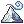 Fôlego de Montanha | Em cada subida: gasta 70% menos estamina extra da subida. | Em cada subida: gasta 95% menos estamina extra da subida e, ao sair dela, recupera 3%. | ao sair da subida, recupera 3% de estamina |
|  Segundo Ar | Quando a estamina cai a 30%, recupera 10% e ganha +3% de velocidade por 8s. | Quando a estamina cai a 35%, recupera 16% e ganha +4,8% de velocidade por 8s. | dispara com 35% de estamina em vez de 30% |
|  Arrancada Final | Na reta final: +2,8% de força na arrancada de Garra. | Na reta final: +4,5% de força na arrancada de Garra, e +1% de velocidade até a chegada. | também +1% de velocidade até a chegada |
|  Dado Viciado | Antes do 1º Dado da Sorte: rola 1 dado extra, de 1 a 60, em todos os Dados da corrida. | Antes do 1º Dado da Sorte: rola 2 dados extras, de 1 a 100, em todos os Dados da corrida. | 2 dados extras, os dois de 1 a 100 |
|  Sol a Pino | Com sol: o bônus do clima para o Fogo sobe de +3% para +7%. | Com sol: o bônus do clima para o Fogo sobe de +3% para +9,4% e continua por 15s depois que o clima muda. | o reforço continua por 15s depois que o clima muda |
| 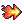 Chama Final | Na reta final: +4% de velocidade por 9,5s. | Na reta final: +6,4% de velocidade por 11s. | dura 11s em vez de 9,5s |
|  Pé na Chuva | Com chuva: o bônus do clima para a Água sobe de +3% para +7%. | Com chuva: o bônus do clima para a Água sobe de +3% para +9,4% e continua por 15s depois que o clima muda. | o reforço continua por 15s depois que o clima muda |
|  Canto da Iara | Na reta final: +4% de velocidade e 20% menos gasto de estamina por 9s. | Na reta final: +6,4% de velocidade e 32% menos gasto de estamina por 9s, e recupera 5% de estamina ao ativar. | também recupera 5% de estamina ao ativar |
| 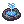 Nascente | Numa reta de 150 m ou mais (fora a da largada): recupera 4,5% de estamina. | Numa reta de 150 m ou mais (fora a da largada): recupera 7,2% de estamina e ganha +3% de velocidade por 4s. | também +3% de velocidade por 4s |
|  Névoa Amiga | Com névoa: o bônus do clima para a Grama sobe de +3% para +7%. | Com névoa: o bônus do clima para a Grama sobe de +3% para +9,4% e continua por 15s depois que o clima muda. | o reforço continua por 15s depois que o clima muda |
| 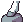 Casco Firme | Em cada subida: +1,2% de rendimento na subida. | Em cada subida: +1,9% de rendimento na subida e gasta 30% menos estamina extra. | na subida, também gasta 30% menos estamina extra |

### Skills de vaga

**Quem pode ter:** as skills gerais servem para qualquer tipo; as de um tipo, só para aquele tipo. O número de skills é limitado pelas vagas da raridade.

**Efeito e descrição:** os números desta lista são os do rank I; o rank multiplica a parte de bônus (ver Rank das skills). **Marco do rank V:** o que a skill ganha a mais no último rank. **Pontos no Poder:** cada skill soma 14 × o peso do gatilho × o fator do rank (gatilhos que nem sempre acontecem valem menos); a lista mostra os pontos no rank I. **Balão:** o texto que aparece na pista quando a skill ativa.

### Gerais (8)

| Skill | Gatilho | Efeito (rank I) | Descrição no jogo (rank I) | Marco do rank V | Quem pode ter | Começa em | Pontos no Poder (rank I; × o fator do rank) | Balão |
| --- | --- | --- | --- | --- | --- | --- | ---: | --- |
|  **Arranque** | Largada | aceleração ×1,108 (+10,8%), por 100 m | Largada explosiva: +10,8% de aceleração nos primeiros 100 m. | também +3% de velocidade nos mesmos 100 m | qualquer tipo | Faísca, Fogaréu | 14 | ARRANQUE |
|  **Sprint** | Entra numa reta de 150 m ou mais (a reta da largada não conta) | velocidade ×1,04 (+4%), por 150 m | Numa reta de 150 m ou mais (fora a da largada): +4% de velocidade por 150 m. | dispara também em retas de 100 m ou mais | qualquer tipo | Ventania | 14 | SPRINT |
|  **Drift** | Entra numa curva | fator da curva +1,3% (somado, teto 1), em cada bloco, até o fim dele | Em cada curva: +1,3% de rendimento na curva. | na curva, também gasta 15% menos estamina | qualquer tipo | Boitatá | 11,2 | DRIFT |
|  **Saída Rápida** | Sai de uma curva | aceleração ×1,32 (+32%); velocidade ×1,045 (+4,5%), por 6 s | Ao sair da curva: +32% de aceleração e +4,5% de velocidade por 6s. | dura 7s em vez de 6s | qualquer tipo | — | 11,2 | SAÍDA RÁPIDA |
|  **Fôlego de Montanha** | Entra numa subida | gasto extra da subida ×0,3 (−70%), em cada bloco, até o fim dele | Em cada subida: gasta 70% menos estamina extra da subida. | ao sair da subida, recupera 3% de estamina | qualquer tipo | Jequitibá | 8,4 | FÔLEGO MONT. |
|  **Segundo Ar** | Estamina cai a 30% ou menos | recupera 10% do tanque na hora; velocidade ×1,03 (+3%), por 8 s | Quando a estamina cai a 30%, recupera 10% e ganha +3% de velocidade por 8s. | dispara com 35% de estamina em vez de 30% | qualquer tipo | Capim, Garoa, Jequitibá | 11,2 | SEGUNDO AR |
|  **Arrancada Final** | Começa a arrancada do cavalo (reta final): em 80% da pista − 14% × (n(GAR) − 0,5), mais cedo com mais Garra | impulso da Garra +2,8 p.p. | Na reta final: +2,8% de força na arrancada de Garra. | também +1% de velocidade até a chegada | qualquer tipo | Ventania | 14 | ARR. FINAL |
|  **Dado Viciado** | Antes do 1º Dado da Sorte (vale para todos os Dados da corrida) | +1 dado no Dado da Sorte, de 1 a 60 (até o fim da corrida) | Antes do 1º Dado da Sorte: rola 1 dado extra, de 1 a 60, em todos os Dados da corrida. | 2 dados extras, os dois de 1 a 100 | qualquer tipo | — | 0 | DADO VICIADO |

### Fogo (2)

| Skill | Gatilho | Efeito (rank I) | Descrição no jogo (rank I) | Marco do rank V | Quem pode ter | Começa em | Pontos no Poder (rank I; × o fator do rank) | Balão |
| --- | --- | --- | --- | --- | --- | --- | ---: | --- |
|  **Sol a Pino** | Clima Sol valendo (checado a cada instante; vale também se o Dado virar o clima) | bônus do clima do próprio elemento ×1,03 → ×1,07 (até o fim da corrida) | Com sol: o bônus do clima para o Fogo sobe de +3% para +7%. | o reforço continua por 15s depois que o clima muda | só Fogo | Fogaréu, Boitatá | 11,2 | SOL A PINO |
|  **Chama Final** | Começa a arrancada do cavalo (reta final): em 80% da pista − 14% × (n(GAR) − 0,5), mais cedo com mais Garra | velocidade ×1,04 (+4%), por 9,5 s | Na reta final: +4% de velocidade por 9,5s. | dura 11s em vez de 9,5s | só Fogo | Tição, Fogaréu, Boitatá | 14 | CHAMA FINAL |

### Água (3)

| Skill | Gatilho | Efeito (rank I) | Descrição no jogo (rank I) | Marco do rank V | Quem pode ter | Começa em | Pontos no Poder (rank I; × o fator do rank) | Balão |
| --- | --- | --- | --- | --- | --- | --- | ---: | --- |
|  **Pé na Chuva** | Clima Chuva valendo (checado a cada instante; vale também se o Dado virar o clima) | bônus do clima do próprio elemento ×1,03 → ×1,07 (até o fim da corrida) | Com chuva: o bônus do clima para a Água sobe de +3% para +7%. | o reforço continua por 15s depois que o clima muda | só Água | Garoa, Pororoca, Iara | 11,2 | PÉ NA CHUVA |
|  **Canto da Iara** | Começa a arrancada do cavalo (reta final): em 80% da pista − 14% × (n(GAR) − 0,5), mais cedo com mais Garra | velocidade ×1,04 (+4%); gasto de estamina ×0,8 (−20%), por 9 s | Na reta final: +4% de velocidade e 20% menos gasto de estamina por 9s. | também recupera 5% de estamina ao ativar | só Água | Iara | 14 | CANTO IARA |
|  **Nascente** | Entra numa reta de 150 m ou mais (a reta da largada não conta) | recupera 4,5% do tanque na hora | Numa reta de 150 m ou mais (fora a da largada): recupera 4,5% de estamina. | também +3% de velocidade por 4s | só Água | Pororoca, Iara | 14 | NASCENTE |

### Grama (2)

| Skill | Gatilho | Efeito (rank I) | Descrição no jogo (rank I) | Marco do rank V | Quem pode ter | Começa em | Pontos no Poder (rank I; × o fator do rank) | Balão |
| --- | --- | --- | --- | --- | --- | --- | ---: | --- |
|  **Névoa Amiga** | Clima Névoa valendo (checado a cada instante; vale também se o Dado virar o clima) | bônus do clima do próprio elemento ×1,03 → ×1,07 (até o fim da corrida) | Com névoa: o bônus do clima para a Grama sobe de +3% para +7%. | o reforço continua por 15s depois que o clima muda | só Grama | — | 11,2 | NÉVOA AMIGA |
|  **Casco Firme** | Entra numa subida | fator da subida +1,2% (somado, teto 1), em cada bloco, até o fim dele | Em cada subida: +1,2% de rendimento na subida. | na subida, também gasta 30% menos estamina extra | só Grama | Mandacaru, Jequitibá | 8,4 | CASCO FIRME |

<a id="dado"></a>

## Dado da Sorte

Quando o líder cruza 1/3 e 2/3 da distância, **todos** rolam o Dado da Sorte (até quem já chegou). Ele usa um fluxo de números próprio da seed, então é determinístico.

1. Cada montaria rola um dado de 1 a 100.
2. Com chance (SOR − 40) / 40 (presa entre 0% e 100%), rola um 2º dado e fica com o melhor. A Sorte vai de 40 a 76 (só de nascimento), então a fórmula começa onde a Sorte começa.
3. Dado Viciado ativa uma vez por corrida, antes do 1º Dado, e soma um dado extra nos 2 Dados: de 1 até o teto do rank (60, 70, 80, 90, 100 do rank I ao V); no rank V, o marco: 2 dados extras, os dois de 1 a 100 (no máximo 4 dados por montaria).
4. O maior dado vence. Empate no topo: só os empatados rolam de novo.
5. O clima vira o do elemento do vencedor. Se já for esse clima, o clima "segura".

| Elemento do vencedor | Clima depois do Dado |
| --- | --- |
| Fogo | Sol |
| Água | Chuva |
| Grama | Névoa |

**Chance de rolar o 2º dado**

| SOR | Chance do 2º dado |
| ---: | ---: |
| 40 | 0% |
| 50 | 25% |
| 56 | 40% |
| 60 | 50% |
| 70 | 75% |
| 76 | 90% |
| 80 | 100% |

<a id="pista"></a>

## Pista e simulação

A pista de cada sala sai da seed: distância de 1.400 a 2.000 m (de 50 em 50 m), de 5 a 9 blocos de tamanhos variados (fronteiras de 10 em 10 m), piso e clima inicial. O primeiro e o último bloco são sempre reta; os do meio são sorteados entre reta, curva e subida.

**Pista sem extremos:** toda pista tem pelo menos uma curva e uma subida, e nenhum tipo de bloco passa de 50% da distância. Se o sorteio não cumpre, os blocos são sorteados de novo (na mesma seed); depois de 60 tentativas entra um molde fixo: reta 15%, curva 30%, reta 10%, subida 30%, reta 15%.

**Frequência em 20.000 seeds**

| Item | Valores |
| --- | --- |
| Composição média (da distância) | Reta 40% (no máximo 50%) · Curva 30% (no máximo 50%) · Subida 30% (no máximo 50%) |
| Piso | Grama 33% · Terra 34% · Areia 33% |
| Clima inicial | Sol 25% · Chuva 25% · Névoa 25% · Nublado 25% |

### Blocos

| Bloco | Fator de velocidade | Gasto de estamina | Observação |
| --- | --- | --- | --- |
| Reta | 1 (sem perda) | normal | Reta de 150 m ou mais (fora a da largada) dispara skills de reta. |
| Curva | min(1, 0,704 + 0,185 × n(MAN) + bônus de skill) — 79,7% (MAN 50) a 98,2% (MAN 150) | normal | Ao sair, a velocidade volta pela Aceleração. |
| Subida | min(1, 0,824 + 0,11 × n(FOR) + bônus de skill) — 87,9% (FOR 50) a 98,9% (FOR 150) | ×(1 + 0,3 × (1 − 0,5 × n(FOR))), e o esforço não cai com a velocidade menor | Ao sair, a velocidade volta pela Aceleração. |

### Pisos

| Piso | Perda de velocidade | Gasto de estamina | Descrição |
| --- | ---: | ---: | --- |
|  Grama | 0% | ×1 | Pista leve. |
|  Terra | −3% | ×1,05 | Pista média: Força ajuda. |
|  Areia | −6% | ×1,12 | Pista pesada: Força ajuda muito. |

A perda de velocidade do piso é aliviada pela Força: perda × (1 − 0,2 × n(FOR)).

Nomes de hipódromo sorteados para a sala (só o nome): Prado do Cerrado, Hipódromo da Lagoa, Raia do Engenho, Prado Beira-Rio, Hipódromo do Planalto, Raia da Ventania, Prado das Palmeiras e Hipódromo do Sertão Velho.

### Como a corrida é simulada

A simulação anda em passos fixos de 0,1 s, só com a seed e os status (sem ruído escondido). Mesma seed e mesma configuração dão o mesmo resultado.

#### Velocidade-alvo

```text
alvo = ritmo × vMax × piso × pelotão × chuva × fator do bloco × boosts × variação (±0,3%)
sobe com a aceleração; desce a 1,37 m/s²
```

#### Ritmo do jóquei

O jóquei calcula o ritmo constante que o tanque restante aguenta até a chegada e guarda 3% de reserva. Ele lê o tanque com um erro sorteado de −0,5% a +2,5% (menor que a reserva: quase nunca cansa). Ritmo: até 97% + 3,5% × (n(EST) − 0,5) da vMax até 72% da pista, depois até 103% + 6,5% × (n(EST) − 0,5) (sprint final); nunca abaixo de 80% por vontade própria. A estimativa já conta as subidas que faltam.

#### Estamina

```text
gasto por segundo = (v / (vMax × boosts × fator da subida))^4 × (1.600 / D)^(2/5) × mods / tanque
tanque = 66 + 20 × n(EST)
mods: piso, sol ×1,04, subida, vácuo −10%, skills
```

Boosts (Garra e skills) sobem o teto sem custo extra de estamina. Pistas longas apertam mais o tanque no total.

#### Vácuo e pelotão

**Vácuo:** quem corre de 0,5 a 4 m atrás de alguém gasta 10% menos estamina. **Pelotão:** com vizinhos a até 2,5 m, a velocidade cai até 3% (teto com 3 vizinhos); a Força alivia 60% × n(FOR) disso (até zerar).

#### Garra

A arrancada de cada montaria começa em 80% − 14% × (n(GAR) − 0,5) da pista (mais Garra, mais cedo; as skills de reta final disparam no mesmo ponto). Lá a arrancada acontece **sempre** (não há chance de falhar). A força média é F = 0 + 0,19 × nc(GAR) (+ bônus de skill); a de cada corrida é F × f, com f sorteado pela seed entre 0 e 2, e o teto de velocidade fica ×(1 + F × f) até a chegada. A Garra decide o quando e o quanto, em média; a seed decide se ela veio fraca ou forte naquela corrida.

#### Cansaço

Estamina zerada: o ritmo cai para 75% até o fim. Se ainda faltar mais de 2% da pista, aparece o aviso "cansou".

#### Largada e eventos

Cada montaria reage à largada com um atraso sorteado de até 0,56 s × (1 − 0,333 × min(n(ACE), 1,5)). Troca de liderança só vira evento depois de 12% da pista, confirmada por 1,5 s e com pelo menos 4 s entre avisos. Depois da chegada o cavalo freia a 8 m/s². A corrida tem teto de 900 s.

#### Traçado (desenho)

O mapa da pista é desenhado dos blocos: retas e subidas em linha reta, e cada sequência de curvas coladas vira uma curva só, que gira 90° a cada 150 m (entre 45° e 180°). É só desenho: a simulação usa os blocos.

<a id="montarias"></a>

## Montarias

Há 3 montarias iniciais e 12 selvagens. Todas são da espécie cavalo. As selvagens aparecem como bots nas corridas, como reprodutores de aluguel no Haras (menos as de raridade Mítico) e 6 delas na vitrine da Expedição. As iniciais também aparecem como bots quando não são suas. Como o level dos bots é escolhido: ver Economia, Rivais da sala.

**Genética** (0 a 31 por status, nota C a S) aparece no jogo, na aba Status da montaria. Os status são os da base (sem pontos comprados). Os bots usam a genética do modelo e distribuem os pontos pela build fixa (ver Economia, Poder e ligas).

### Iniciais (3)

#### Brasa — A fagulha veloz

Fogo · Comum · ★★ · ♂ macho · Nv 1 · Poder 629 (Bronze) · 2 cruza(s)

Potro alazão de crina dourada. Larga como um rojão.

Skill de tipo: Labareda · Skills: nenhuma · Onde aparece: montaria inicial, bot nas corridas (quando não é a sua)

|  | VEL | ACE | MAN | FOR | EST | GAR | SOR |
| --- | ---: | ---: | ---: | ---: | ---: | ---: | ---: |
| Nv 1 | 52 | 52 | 47 | 46 | 46 | 47 | 46 |
| Genética | 24 | 24 | 14 | 12 | 12 | 14 | 12 |
| No Nv 1 | 52 | 52 | 47 | 46 | 46 | 47 | 46 |

#### Maré — O fôlego do oceano

Água · Comum · ★★ · ♀ fêmea · Nv 1 · Poder 626 (Bronze) · 1 cruza(s)

Égua tordilha de crina cor do mar. Quanto mais longa a pista, mais perigosa.

Skill de tipo: Maré Alta · Skills: nenhuma · Onde aparece: montaria inicial, bot nas corridas (quando não é a sua)

|  | VEL | ACE | MAN | FOR | EST | GAR | SOR |
| --- | ---: | ---: | ---: | ---: | ---: | ---: | ---: |
| Nv 1 | 47 | 46 | 46 | 47 | 52 | 52 | 46 |
| Genética | 14 | 12 | 12 | 14 | 24 | 24 | 12 |
| No Nv 1 | 47 | 46 | 46 | 47 | 52 | 52 | 46 |

#### Ipê — A raiz que não verga

Grama · Comum · ★★ · ♂ macho · Nv 1 · Poder 633 (Bronze) · 2 cruza(s)

Castanho robusto de crina amarela como ipê florido. Não teme subida.

Skill de tipo: Raízes Firmes · Skills: nenhuma · Onde aparece: montaria inicial, bot nas corridas (quando não é a sua)

|  | VEL | ACE | MAN | FOR | EST | GAR | SOR |
| --- | ---: | ---: | ---: | ---: | ---: | ---: | ---: |
| Nv 1 | 48 | 46 | 52 | 52 | 47 | 46 | 45 |
| Genética | 16 | 12 | 24 | 24 | 14 | 12 | 10 |
| No Nv 1 | 48 | 46 | 52 | 52 | 47 | 46 | 45 |

### Selvagens (12)

#### Faísca

Fogo · Comum · ★★ · ♀ fêmea · Nv 3 · Poder 617 (Bronze) · 1 cruza(s)

Habitat: Cerrado seco.

Skill de tipo: Labareda · Skills: Arranque · Onde aparece: bot nas corridas, aluguel no Haras (125 de Ouro)

|  | VEL | ACE | MAN | FOR | EST | GAR | SOR |
| --- | ---: | ---: | ---: | ---: | ---: | ---: | ---: |
| Nv 1 | 47 | 48 | 48 | 45 | 44 | 46 | 45 |
| Genética | 14 | 16 | 15 | 10 | 8 | 12 | 10 |
| No Nv 3 | 47 | 48 | 48 | 45 | 44 | 46 | 45 |

#### Lambari

Água · Comum · ★ · ♂ macho · Nv 2 · Poder 602 (Bronze) · 2 cruza(s)

Habitat: Beira de rio.

Skill de tipo: Maré Alta · Skills: nenhuma · Onde aparece: bot nas corridas, aluguel no Haras (100 de Ouro)

|  | VEL | ACE | MAN | FOR | EST | GAR | SOR |
| --- | ---: | ---: | ---: | ---: | ---: | ---: | ---: |
| Nv 1 | 45 | 46 | 45 | 46 | 49 | 47 | 45 |
| Genética | 9 | 11 | 10 | 12 | 17 | 13 | 10 |
| No Nv 2 | 45 | 46 | 45 | 46 | 49 | 47 | 45 |

#### Capim

Grama · Comum · ★★ · ♀ fêmea · Nv 4 · Poder 613 (Bronze) · 1 cruza(s)

Habitat: Campos gerais.

Skill de tipo: Raízes Firmes · Skills: Segundo Ar · Onde aparece: bot nas corridas, aluguel no Haras (125 de Ouro)

|  | VEL | ACE | MAN | FOR | EST | GAR | SOR |
| --- | ---: | ---: | ---: | ---: | ---: | ---: | ---: |
| Nv 1 | 45 | 45 | 45 | 49 | 47 | 46 | 45 |
| Genética | 10 | 10 | 10 | 18 | 13 | 12 | 10 |
| No Nv 4 | 45 | 45 | 45 | 49 | 47 | 46 | 45 |

#### Tição

Fogo · Mágico · ★★ · ♂ macho · Nv 8 · Poder 697 (Bronze) · 2 cruza(s)

Habitat: Carvoaria abandonada.

Skill de tipo: Labareda · Skills: Chama Final · Onde aparece: bot nas corridas, aluguel no Haras (313 de Ouro)

|  | VEL | ACE | MAN | FOR | EST | GAR | SOR |
| --- | ---: | ---: | ---: | ---: | ---: | ---: | ---: |
| Nv 1 | 53 | 54 | 53 | 50 | 49 | 52 | 50 |
| Genética | 17 | 19 | 18 | 12 | 10 | 15 | 12 |
| No Nv 8 | 53 | 54 | 53 | 50 | 49 | 52 | 50 |

#### Garoa

Água · Mágico · ★★ · ♀ fêmea · Nv 10 · Poder 703 (Bronze) · 1 cruza(s)

Habitat: Serra enevoada.

Skill de tipo: Maré Alta · Skills: Pé na Chuva, Segundo Ar · Onde aparece: bot nas corridas, aluguel no Haras (313 de Ouro)

|  | VEL | ACE | MAN | FOR | EST | GAR | SOR |
| --- | ---: | ---: | ---: | ---: | ---: | ---: | ---: |
| Nv 1 | 51 | 50 | 51 | 51 | 54 | 52 | 50 |
| Genética | 13 | 12 | 13 | 14 | 20 | 15 | 12 |
| No Nv 10 | 51 | 50 | 51 | 51 | 54 | 52 | 50 |

#### Mandacaru

Grama · Mágico · ★★ · ♂ macho · Nv 7 · Poder 690 (Bronze) · 2 cruza(s)

Habitat: Caatinga.

Skill de tipo: Raízes Firmes · Skills: Casco Firme · Onde aparece: bot nas corridas, aluguel no Haras (313 de Ouro)

|  | VEL | ACE | MAN | FOR | EST | GAR | SOR |
| --- | ---: | ---: | ---: | ---: | ---: | ---: | ---: |
| Nv 1 | 50 | 51 | 51 | 55 | 52 | 51 | 50 |
| Genética | 12 | 13 | 13 | 21 | 16 | 13 | 12 |
| No Nv 7 | 50 | 51 | 51 | 55 | 52 | 51 | 50 |

#### Ventania

Grama · Raro · ★★★ · ♀ fêmea · Nv 15 · Poder 802 (Ouro) · 1 cruza(s)

Habitat: Pampa gaúcho.

Skill de tipo: Raízes Firmes · Skills: Sprint, Arrancada Final · Onde aparece: bot nas corridas, aluguel no Haras (900 de Ouro)

|  | VEL | ACE | MAN | FOR | EST | GAR | SOR |
| --- | ---: | ---: | ---: | ---: | ---: | ---: | ---: |
| Nv 1 | 60 | 58 | 59 | 56 | 57 | 58 | 56 |
| Genética | 21 | 18 | 20 | 13 | 15 | 17 | 14 |
| No Nv 15 | 60 | 58 | 59 | 56 | 57 | 58 | 56 |

#### Pororoca

Água · Raro · ★★ · ♂ macho · Nv 18 · Poder 797 (Prata) · 2 cruza(s)

Habitat: Foz do Amazonas.

Skill de tipo: Maré Alta · Skills: Nascente, Pé na Chuva · Onde aparece: bot nas corridas, aluguel no Haras (750 de Ouro)

|  | VEL | ACE | MAN | FOR | EST | GAR | SOR |
| --- | ---: | ---: | ---: | ---: | ---: | ---: | ---: |
| Nv 1 | 57 | 56 | 57 | 58 | 61 | 57 | 56 |
| Genética | 15 | 14 | 15 | 17 | 24 | 16 | 14 |
| No Nv 18 | 57 | 56 | 57 | 58 | 61 | 57 | 56 |

#### Fogaréu

Fogo · Lendário · ★★★ · ♀ fêmea · Nv 22 · Poder 909 (Platina) · 1 cruza(s)

Habitat: Chapada em chamas.

Skill de tipo: Labareda · Skills: Sol a Pino, Chama Final, Arranque · Onde aparece: bot nas corridas, aluguel no Haras (2.250 de Ouro)

|  | VEL | ACE | MAN | FOR | EST | GAR | SOR |
| --- | ---: | ---: | ---: | ---: | ---: | ---: | ---: |
| Nv 1 | 66 | 67 | 67 | 62 | 62 | 64 | 62 |
| Genética | 24 | 26 | 25 | 16 | 15 | 20 | 16 |
| No Nv 22 | 66 | 67 | 67 | 62 | 62 | 64 | 62 |

#### Jequitibá

Grama · Lendário · ★★★ · ♂ macho · Nv 25 · Poder 894 (Platina) · 2 cruza(s)

Habitat: Mata Atlântica.

Skill de tipo: Raízes Firmes · Skills: Casco Firme, Fôlego de Montanha, Segundo Ar · Onde aparece: bot nas corridas, aluguel no Haras (2.250 de Ouro)

|  | VEL | ACE | MAN | FOR | EST | GAR | SOR |
| --- | ---: | ---: | ---: | ---: | ---: | ---: | ---: |
| Nv 1 | 63 | 62 | 63 | 68 | 65 | 64 | 62 |
| Genética | 17 | 16 | 17 | 27 | 21 | 19 | 16 |
| No Nv 25 | 63 | 62 | 63 | 68 | 65 | 64 | 62 |

#### Boitatá

Fogo · Mítico · ★★★ · ♀ fêmea · Nv 30 · Poder 1.024 (Diamante) · 1 cruza(s)

Habitat: Só aparece em noites de queimada. A cobra de fogo do folclore, em forma de cavalo.

Skill de tipo: Labareda · Skills: Sol a Pino, Chama Final, Drift · Onde aparece: bot nas corridas

|  | VEL | ACE | MAN | FOR | EST | GAR | SOR |
| --- | ---: | ---: | ---: | ---: | ---: | ---: | ---: |
| Nv 1 | 74 | 75 | 75 | 71 | 70 | 73 | 69 |
| Genética | 28 | 29 | 29 | 21 | 20 | 26 | 18 |
| No Nv 30 | 74 | 75 | 75 | 71 | 70 | 73 | 69 |

#### Iara

Água · Mítico · ★★★ · ♂ macho · Nv 28 · Poder 1.011 (Diamante) · 2 cruza(s)

Habitat: Rios encantados. A mãe-d'água que encanta quem a ouve.

Skill de tipo: Maré Alta · Skills: Canto da Iara, Pé na Chuva, Nascente · Onde aparece: bot nas corridas

|  | VEL | ACE | MAN | FOR | EST | GAR | SOR |
| --- | ---: | ---: | ---: | ---: | ---: | ---: | ---: |
| Nv 1 | 71 | 71 | 71 | 70 | 75 | 73 | 69 |
| Genética | 22 | 21 | 22 | 20 | 30 | 25 | 18 |
| No Nv 28 | 71 | 71 | 71 | 70 | 75 | 73 | 69 |

<a id="marcas"></a>

## Marcas e jóquei

Marcas, jóquei e brilho da raridade são só desenho: não entram em status, Poder, preço nem na corrida. Cada cavalo carrega 3 genes de marcas, que o potro herda pela seed do cruzamento.

### Genes de marcas

| Gene | Valores | Quantos |
| --- | --- | ---: |
| Cara | nenhuma, estrela, listra e frente branca | 4 |
| Patas | 0, 1, 2, 3 e 4 meias brancas | 5 |
| Corpo | liso, malhado (manchas brancas grandes), pintado (pintas escuras pequenas) e ruão (pelos brancos salpicados) | 4 |

### Herança no cruzamento

- Cada gene (cara, patas, corpo, nessa ordem) vem de um dos pais, 50% para cada um (égua ou garanhão), com 10% de chance de **mutação**: o gene vira um valor qualquer da lista, com a mesma chance para todos.
- Os sorteios das marcas usam uma sequência própria da seed do cruzamento. O resto do potro (raridade, estrelas, genética, skills) nasce igual a antes de existirem marcas.
- Cavalo sem marcas válidas (save antigo) vale pelas marcas do modelo do catálogo ou, na falta dele, por marcas calculadas do identificador dele: o mesmo cavalo tem sempre as mesmas marcas.
- Mítico nunca nasce de cruzamento, com ou sem marcas. A ficha da montaria e o Haras mostram a linha "Marcas: …".

### Jóquei do jogador

- Na aba Perfil você escolhe o **padrão da seda** (liso, listras, faixa, xadrez, estrelas e losangos) e a **cor do capacete** (8 cores). O padrão inicial é "liso" e o capacete inicial é Dourado. Cores de capacete: Dourado, Vermelho, Azul, Verde, Roxo, Laranja, Creme e Preto.
- A seda continua na cor de sempre (a sua é dourada; a dos rivais é a cor da raia); o padrão vai por cima em um tom mais claro ou mais escuro. A escolha vale para todos os seus cavalos.
- O jóquei dos rivais (padrão e capacete) sai da seed da sala.

### Raridade visível

Cada raridade ganha um efeito na cor dela. O brilho da crina corre a cada 1,2 s, na cor da raridade clareada; numa crina em que essa cor quase não aparece, na clareada ou na escurecida, a que mais se destaca. Com movimento reduzido, o brilho fica parado, as faíscas ficam fixas e não há rastro.

| Raridade | Efeito |
| --- | --- |
| Comum | nada |
| Mágico | brilho na crina (mistura de 25% da cor da raridade) |
| Raro | brilho na crina (mistura de 30% da cor da raridade) e 3 faíscas piscando em volta |
| Lendário | brilho na crina (mistura de 45% da cor da raridade) e 5 faíscas piscando em volta |
| Mítico | brilho na crina (mistura de 45% da cor da raridade) e 5 faíscas piscando em volta e rastro de luz atrás do cavalo no galope da corrida |

### Marcas dos iniciais e selvagens

| Cavalo | Cara | Patas (meias) | Corpo |
| --- | --- | ---: | --- |
| Brasa | estrela | 1 | liso |
| Maré | listra | 0 | ruão (pelos brancos salpicados) |
| Ipê | frente branca | 2 | liso |
| Faísca | estrela | 2 | pintado (pintas escuras pequenas) |
| Lambari | nenhuma | 0 | malhado (manchas brancas grandes) |
| Capim | listra | 4 | liso |
| Tição | frente branca | 1 | liso |
| Garoa | estrela | 0 | ruão (pelos brancos salpicados) |
| Mandacaru | nenhuma | 3 | pintado (pintas escuras pequenas) |
| Ventania | listra | 2 | malhado (manchas brancas grandes) |
| Pororoca | estrela | 4 | liso |
| Fogaréu | frente branca | 0 | pintado (pintas escuras pequenas) |
| Jequitibá | listra | 1 | ruão (pelos brancos salpicados) |
| Boitatá | estrela | 2 | malhado (manchas brancas grandes) |
| Iara | nenhuma | 4 | ruão (pelos brancos salpicados) |

<a id="portes"></a>

## Portes

O porte é o tamanho e a forma do corpo do cavalo. Como as marcas, é só desenho: não entra em status, Poder, preço, aluguel nem na corrida. O mesmo porte tem o mesmo corpo nos três elementos.

| Porte | Como se reconhece de lado |
| --- | --- |
| Esguio | pernas longas e finas, pescoço comprido, cabeça pequena, cauda alta |
| Padrão | meio-termo: corpo equilibrado, perfil de cabeça levemente curvo |
| Robusto | mais baixo e largo, peito e pescoço grossos, pernas curtas e fortes, crina farta |

### Herança no cruzamento

- O potro herda o porte de um dos pais (égua ou garanhão), 50% para cada um, com 10% de chance de **mutação**: o porte vira um dos 3 da lista, com a mesma chance para todos (pode sair o mesmo).
- O sorteio usa uma sequência própria da seed do cruzamento, separada das marcas. O resto do potro nasce igual a antes de existirem portes.
- Cavalo sem porte válido (save antigo) vale pelo porte do modelo do catálogo ou, na falta dele, por um porte calculado do identificador dele: o mesmo cavalo tem sempre o mesmo porte. O padrão do jogo é Padrão.
- Mítico nunca nasce de cruzamento, com ou sem porte.

### Porte dos iniciais e selvagens

| Cavalo | Elemento | Porte |
| --- | --- | --- |
| Brasa | Fogo | Padrão |
| Maré | Água | Padrão |
| Ipê | Grama | Padrão |
| Faísca | Fogo | Esguio |
| Lambari | Água | Esguio |
| Capim | Grama | Esguio |
| Tição | Fogo | Robusto |
| Garoa | Água | Padrão |
| Mandacaru | Grama | Robusto |
| Ventania | Grama | Esguio |
| Pororoca | Água | Robusto |
| Fogaréu | Fogo | Robusto |
| Jequitibá | Grama | Robusto |
| Boitatá | Fogo | Esguio |
| Iara | Água | Esguio |

<a id="cruzamento"></a>

## Cruzamento (Haras)

No Haras uma égua (♀) e um garanhão (♂) geram um potro. O sorteio é determinístico (seed do save e contador de cruzas). O potro nasce na hora, no level 1 (ainda não existe gestação no protótipo).

### Regras e custos

- **Cruzar com aluguel:** com um selvagem de sexo oposto; custa o aluguel dele (tabela abaixo). Mítico não se aluga.
- **Cruzar duas suas:** registro de 50 de Ouro; as duas precisam ter cruzas restantes e cada uma gasta 1.
- **Troca:** duas montarias suas de sexos opostos, com qualquer número de cruzas, viram um potro por 50 de Ouro. Os dois pais deixam o estábulo.
- **Cruzas restantes ao nascer:** macho 2, fêmea 1. Cada cruza gasta 1 da sua montaria.
- **Estábulo:** cruzar exige vaga livre (o potro ocupa uma). Vagas: 2 no começo, até 5 pelo Ouro; a próxima vaga custa 2.000 (3ª), 10.000 (4ª) e 50.000 (5ª) de Ouro. Saves de antes de 2026-11-26 ficam com as vagas que já tinham (até 8).
- Não dá para cruzar com um páreo aberto (sala paga ou não).

**Preço do aluguel (base × estrelas)**

| Raridade | ★ | ★★ | ★★★ |
| --- | --- | --- | --- |
| Comum | 100 | 125 | 150 |
| Mágico | 250 | 313 | 375 |
| Raro | 600 | 750 | 900 |
| Lendário | 1.500 | 1.875 | 2.250 |

**Reprodutores de aluguel**

| Montaria | Sexo | Elemento | Raridade | Estrelas | Level | Aluguel |
| --- | --- | --- | --- | ---: | ---: | --- |
| Faísca | ♀ fêmea | Fogo | Comum | ★★ | 3 | 125 |
| Lambari | ♂ macho | Água | Comum | ★ | 2 | 100 |
| Capim | ♀ fêmea | Grama | Comum | ★★ | 4 | 125 |
| Tição | ♂ macho | Fogo | Mágico | ★★ | 8 | 313 |
| Garoa | ♀ fêmea | Água | Mágico | ★★ | 10 | 313 |
| Mandacaru | ♂ macho | Grama | Mágico | ★★ | 7 | 313 |
| Ventania | ♀ fêmea | Grama | Raro | ★★★ | 15 | 900 |
| Pororoca | ♂ macho | Água | Raro | ★★ | 18 | 750 |
| Fogaréu | ♀ fêmea | Fogo | Lendário | ★★★ | 22 | 2.250 |
| Jequitibá | ♂ macho | Grama | Lendário | ★★★ | 25 | 2.250 |

### Fator de nível (L)

```text
L = clamp((0,6 × level da égua + 0,4 × level do garanhão) / 30, 0, 1)
```

L vai de 0 (pior) a 1 (melhor). As chances são interpoladas em linha reta entre a coluna "L = 0" e a "L = 1". Dois pais no level 1 dão L = 0,033.

### Raridade do potro

A base é a **menor** raridade entre os pais. O potro pode nascer 1 abaixo, igual, 1 acima ou 2 acima; pais da mesma raridade usam a linha "igual", pais diferentes a linha "misturada". O resultado nunca passa de Lendário (o que passaria soma no limite).

| Linha | L | 1 abaixo | Igual | 1 acima | 2 acima |
| --- | --- | ---: | ---: | ---: | ---: |
| Mesma raridade | L = 0 | 45% | 54% | 1% | 0% |
| Mesma raridade | L = 1 | 30% | 65% | 4,5% | 0,5% |
| Raridades diferentes | L = 0 | 35% | 50% | 15% | 0% |
| Raridades diferentes | L = 1 | 20% | 50% | 29% | 1% |

**Raridade do potro com L = 0 (piso)**

| Pais | Comum | Mágico | Raro | Lendário | Mítico |
| --- | ---: | ---: | ---: | ---: | ---: |
| Comum × Comum | 99% | 1% | — | — | — |
| Comum × Mágico | 85% | 15% | — | — | — |
| Comum × Raro | 85% | 15% | — | — | — |
| Comum × Lendário | 85% | 15% | — | — | — |
| Mágico × Mágico | 45% | 54% | 1% | — | — |
| Mágico × Raro | 35% | 50% | 15% | — | — |
| Mágico × Lendário | 35% | 50% | 15% | — | — |
| Raro × Raro | — | 45% | 54% | 1% | — |
| Raro × Lendário | — | 35% | 50% | 15% | — |
| Lendário × Lendário | — | — | 45% | 55% | — |

**Raridade do potro com L = 1 (nível efetivo 30 ou mais)**

| Pais | Comum | Mágico | Raro | Lendário | Mítico |
| --- | ---: | ---: | ---: | ---: | ---: |
| Comum × Comum | 95% | 4,5% | 0,5% | — | — |
| Comum × Mágico | 70% | 29% | 1% | — | — |
| Comum × Raro | 70% | 29% | 1% | — | — |
| Comum × Lendário | 70% | 29% | 1% | — | — |
| Mágico × Mágico | 30% | 65% | 4,5% | 0,5% | — |
| Mágico × Raro | 20% | 50% | 29% | 1% | — |
| Mágico × Lendário | 20% | 50% | 29% | 1% | — |
| Raro × Raro | — | 30% | 65% | 5% | — |
| Raro × Lendário | — | 20% | 50% | 30% | — |
| Lendário × Lendário | — | — | 30% | 70% | — |

### Sorte dos pais

A genética de Sorte dos pais (0 a 31) melhora as chances: s = 0,6 × genética da égua ÷ 31 + 0,4 × genética do garanhão ÷ 31 (de 0 a 1). Depois da interpolação por L, até **5 × s pontos percentuais** saem da coluna "1 abaixo" e entram na "1 acima"; nas estrelas, saem de "desce" e entram em "sobe" (nunca mais do que a coluna tem). As tabelas acima e abaixo são sem Sorte (s = 0). Com genética de Sorte 31 nos dois pais, dois Raros no level 30 dão 10% de Lendário (sem Sorte, 5%). O sorteio é o mesmo, pela seed (só mudam os limites), e Mítico continua sem nascer de cruzamento.

### Estrelas do potro

As estrelas do potro multiplicam os pontos que ele ganha por level (ver Raridades). Estrelas base = arredondar(0,6 × estrelas da égua + 0,4 × estrelas do garanhão). Se a raridade **subiu**, o potro nasce ★; se **desceu**, nasce ★★★. Se manteve, sorteia desce/mantém/sobe (fora de 1–3 soma em "mantém").

| Estrelas base | L | ★ | ★★ | ★★★ |
| ---: | --- | ---: | ---: | ---: |
| ★ | L = 0 | 80% | 20% | — |
| ★ | L = 1 | 60% | 40% | — |
| ★★ | L = 0 | 25% | 55% | 20% |
| ★★ | L = 1 | 10% | 50% | 40% |
| ★★★ | L = 0 | — | 25% | 75% |
| ★★★ | L = 1 | — | 10% | 90% |

### Tipo, sexo e genética

- **Tipo:** se os pais têm o mesmo, o potro herda; senão, 50% de chance de cada um. A skill de tipo vem com o tipo.
- **Sexo:** 50% fêmea, 50% macho.
- **Genética:** para cada status, 50% de chance de herdar a de um dos pais (50% para cada); senão sai de 0 a 31. Os status do potro saem da genética e da raridade; ele nasce no level 1, sem pontos.
- **Nome:** sorteado entre 32: Tufão, Canela, Baio, Pitanga, Jaguar, Serena, Relâmpago, Mimosa, Trovão, Lua, Corisco, Pérola, Faísca II, Aroeira, Bugre, Catira, Dourado, Estrela, Furacão, Guará, Jurema, Malhado, Nuvem, Onça, Pampa, Quimera, Rio, Saci, Tempestade, Umbu, Vaqueiro e Xodó.
- **Cores:** mistura das cores dos pais.

### Skills do potro

1. Candidatas: as skills de vaga dos pais que servem para o tipo do potro.
2. Corcel: com 1 pai Corcel, 1 skill garantida (50% de chance de 2); com os 2 pais Corcel, 2 garantidas.
3. Cada candidata restante passa com 35% de chance.
4. Corte nas vagas da raridade do potro.
5. Se ficou abaixo das skills ao nascer da raridade, completa com skills sorteadas que servem para o tipo.
6. Rank: cada skill herdada nasce 1 rank abaixo do pai que a tem (se os dois têm, vale o maior), nunca abaixo do I; a skill sorteada para completar nasce no rank I. O rank não usa sorteio (ver Skills, Rank das skills).

<a id="equipamento"></a>

## Equipamento

> **Só vale no treino AFK (PVE).** O equipamento nunca entra na corrida valendo, na sala, no Poder nem nos duelos de ginásio: lá todo cavalo corre sem peças.

Cada montaria tem 5 slots. Cada peça soma um **status principal de corrida** (o valor da raridade + a melhoria), definido pelo slot, e tem **linhas de farm** sorteadas pela seed quando a peça nasce. Peças Comum e Mágico são soltas; Raro e Lendário pertencem a um conjunto (Sol, Chuva e Névoa). O status da corrida é inteiro: a soma das peças de um slot é arredondada (2,25 vira +2).

| Slot | Status principal |
| --- | --- |
| Ferraduras | Velocidade |
| Sela | Estamina |
| Estribos | Manobra |
| Testeira | Aceleração |
| Armadura | Força |

| Raridade | Principal | Linhas de farm | Preço | Venda | Na loja |
| --- | ---: | ---: | --- | --- | --- |
| Comum | +0,75 | 0 | 100 | 25 | sim |
| Mágico | +1 | 1 | 250 | 63 | sim |
| Raro | +1,25 | 2 | 600 | 150 | sim |
| Lendário | +1,75 | 3 | 1.500 | 375 | **nunca à venda** |

Venda devolve 25% do preço. Peças Lendário nunca estão à venda. Equipamento inicial: Sela de Couro Cru e Ferradura Leve.

### Linhas de farm

Cada linha tem um tipo (sem repetir na mesma peça) e um valor inteiro em pontos percentuais, sorteado na faixa da raridade (sorteio uniforme). Os percentuais das peças equipadas somam entre si e multiplicam o ganho do treino AFK daquele cavalo (com o bestiário). A melhoria sobe só o principal.

| Tipo | Mágico | Raro | Lendário |
| --- | ---: | ---: | ---: |
| Material do ginásio | 3–6% | 6–10% | 10–15% |
| XP | 3–6% | 6–10% | 10–15% |
| Drop raro (incomum, Pedra Negra, peça, comida) | 2–5% | 5–8% | 8–12% |
| Chance de troféu | 6–12% | 12–20% | 20–30% |
| Ouro do treino | 2–4% | 4–6% | 6–10% |

### Catálogo completo

| Peça | Slot | Raridade | Conjunto | Principal | Preço | Loja |
| --- | --- | --- | --- | ---: | --- | --- |
| **Ferradura Leve** | Ferraduras | Comum | — | +0,75 VEL | 100 | sim |
| **Ferradura com Cravos** | Ferraduras | Mágico | — | +1 VEL | 250 | sim |
| **Ferraduras do Sol** | Ferraduras | Raro | Sol | +1,25 VEL | 600 | sim |
| **Ferraduras do Sol** | Ferraduras | Lendário | Sol | +1,75 VEL | 1.500 | não |
| **Ferraduras da Chuva** | Ferraduras | Raro | Chuva | +1,25 VEL | 600 | sim |
| **Ferraduras da Chuva** | Ferraduras | Lendário | Chuva | +1,75 VEL | 1.500 | não |
| **Ferraduras da Névoa** | Ferraduras | Raro | Névoa | +1,25 VEL | 600 | sim |
| **Ferraduras da Névoa** | Ferraduras | Lendário | Névoa | +1,75 VEL | 1.500 | não |
| **Sela de Couro Cru** | Sela | Comum | — | +0,75 EST | 100 | sim |
| **Sela Acolchoada** | Sela | Mágico | — | +1 EST | 250 | sim |
| **Sela do Sol** | Sela | Raro | Sol | +1,25 EST | 600 | sim |
| **Sela do Sol** | Sela | Lendário | Sol | +1,75 EST | 1.500 | não |
| **Sela da Chuva** | Sela | Raro | Chuva | +1,25 EST | 600 | sim |
| **Sela da Chuva** | Sela | Lendário | Chuva | +1,75 EST | 1.500 | não |
| **Sela da Névoa** | Sela | Raro | Névoa | +1,25 EST | 600 | sim |
| **Sela da Névoa** | Sela | Lendário | Névoa | +1,75 EST | 1.500 | não |
| **Estribos de Corda** | Estribos | Comum | — | +0,75 MAN | 100 | sim |
| **Esporas de Prata** | Estribos | Mágico | — | +1 MAN | 250 | sim |
| **Estribos do Sol** | Estribos | Raro | Sol | +1,25 MAN | 600 | sim |
| **Estribos do Sol** | Estribos | Lendário | Sol | +1,75 MAN | 1.500 | não |
| **Estribos da Chuva** | Estribos | Raro | Chuva | +1,25 MAN | 600 | sim |
| **Estribos da Chuva** | Estribos | Lendário | Chuva | +1,75 MAN | 1.500 | não |
| **Estribos da Névoa** | Estribos | Raro | Névoa | +1,25 MAN | 600 | sim |
| **Estribos da Névoa** | Estribos | Lendário | Névoa | +1,75 MAN | 1.500 | não |
| **Antolhos** | Testeira | Comum | — | +0,75 ACE | 100 | sim |
| **Testeira de Couro** | Testeira | Mágico | — | +1 ACE | 250 | sim |
| **Testeira do Sol** | Testeira | Raro | Sol | +1,25 ACE | 600 | sim |
| **Testeira do Sol** | Testeira | Lendário | Sol | +1,75 ACE | 1.500 | não |
| **Testeira da Chuva** | Testeira | Raro | Chuva | +1,25 ACE | 600 | sim |
| **Testeira da Chuva** | Testeira | Lendário | Chuva | +1,75 ACE | 1.500 | não |
| **Testeira da Névoa** | Testeira | Raro | Névoa | +1,25 ACE | 600 | sim |
| **Testeira da Névoa** | Testeira | Lendário | Névoa | +1,75 ACE | 1.500 | não |
| **Manta de Lã** | Armadura | Comum | — | +0,75 FOR | 100 | sim |
| **Capa Impermeável** | Armadura | Mágico | — | +1 FOR | 250 | sim |
| **Armadura do Sol** | Armadura | Raro | Sol | +1,25 FOR | 600 | sim |
| **Armadura do Sol** | Armadura | Lendário | Sol | +1,75 FOR | 1.500 | não |
| **Armadura da Chuva** | Armadura | Raro | Chuva | +1,25 FOR | 600 | sim |
| **Armadura da Chuva** | Armadura | Lendário | Chuva | +1,75 FOR | 1.500 | não |
| **Armadura da Névoa** | Armadura | Raro | Névoa | +1,25 FOR | 600 | sim |
| **Armadura da Névoa** | Armadura | Lendário | Névoa | +1,75 FOR | 1.500 | não |

### Melhoria (+1 a +10)

Cada tentativa gasta Pedras Negras e tem uma chance de sucesso (sorteio pela seed do save). A partir de +6, a falha **derruba** a peça 1 nível. Cada + soma 0,2 no status principal (uma peça +10 soma +2). Pedra Negra: 40 de Ouro na loja (pacote de 5 = 200); também cai no treino AFK e sai da forja.

| Passo | Chance | Custo (pedras) | Se falhar | Pedras esperadas no passo | Pedras esperadas desde +0 |
| --- | ---: | ---: | --- | ---: | ---: |
| +0 → +1 | 100% | 1 | fica em +0 | 1 | 1 |
| +1 → +2 | 90% | 1 | fica em +1 | 1,1 | 2,1 |
| +2 → +3 | 80% | 1 | fica em +2 | 1,3 | 3,4 |
| +3 → +4 | 70% | 1 | fica em +3 | 1,4 | 4,8 |
| +4 → +5 | 60% | 1 | fica em +4 | 1,7 | 6,5 |
| +5 → +6 | 50% | 1 | fica em +5 | 2 | 8,5 |
| +6 → +7 | 40% | 2 | cai para +5 | 8 | 16,5 |
| +7 → +8 | 35% | 2 | cai para +6 | 20,6 | 37 |
| +8 → +9 | 30% | 2 | cai para +7 | 54,7 | 91,7 |
| +9 → +10 | 25% | 2 | cai para +8 | 172 | 263,7 |

**Pedra Negra do pódio:** desligada (a corrida valendo dá o Pergaminho de técnica); a Pedra vem da loja, do treino AFK e da forja.

### Conjuntos

| Conjunto | Clima | Elemento favorecido | Peças |
| --- | --- | --- | --- |
| Sol | Sol | Fogo | Ferraduras do Sol (Raro), Ferraduras do Sol (Lendário), Sela do Sol (Raro), Sela do Sol (Lendário), Estribos do Sol (Raro), Estribos do Sol (Lendário), Testeira do Sol (Raro), Testeira do Sol (Lendário), Armadura do Sol (Raro), Armadura do Sol (Lendário) |
| Chuva | Chuva | Água | Ferraduras da Chuva (Raro), Ferraduras da Chuva (Lendário), Sela da Chuva (Raro), Sela da Chuva (Lendário), Estribos da Chuva (Raro), Estribos da Chuva (Lendário), Testeira da Chuva (Raro), Testeira da Chuva (Lendário), Armadura da Chuva (Raro), Armadura da Chuva (Lendário) |
| Névoa | Névoa | Grama | Ferraduras da Névoa (Raro), Ferraduras da Névoa (Lendário), Sela da Névoa (Raro), Sela da Névoa (Lendário), Estribos da Névoa (Raro), Estribos da Névoa (Lendário), Testeira da Névoa (Raro), Testeira da Névoa (Lendário), Armadura da Névoa (Raro), Armadura da Névoa (Lendário) |

**Bônus total por número de peças do mesmo conjunto (cada linha já é o total; só no treino AFK)**

| Peças | Bônus |
| ---: | --- |
| 3 | linhas de farm +10% (cada bônus × 1,1) |
| 4 | linhas de farm +10% (cada bônus × 1,1); no clima do conjunto, o bônus do elemento dono sobe para ×1,07 (não acumula com a skill de clima: vale o maior) |
| 5 | linhas de farm +10% (cada bônus × 1,1); no clima do conjunto, o bônus do elemento dono sobe para ×1,07 (não acumula com a skill de clima: vale o maior); anula a penalidade de clima (×0,97 vira ×1) |

Cada linha é o total daquele patamar, não soma com as de cima. Vale o conjunto com mais peças equipadas (empate: Sol, Chuva e Névoa, nessa ordem).

### Peças dos oponentes do treino AFK

| Dificuldade | Peças do oponente |
| --- | --- |
| Normal | sem peças |
| Difícil | 5 Mágicos +3 (+1,6 em cada status principal) |
| Lendária | 5 Raros +5 do conjunto do ginásio (+2,25 em cada status principal) |

Os bots da sala e os oponentes dos ginásios de verdade correm sempre sem peças.

<a id="economia"></a>

## Economia

Moeda única hoje: **Ouro**. Começa com 500. Ganha-se Ouro correndo (prêmios e treino), na recompensa diária (Ouro que entra sem precisar correr; ver Itens), nos prêmios dos ginásios (a 1ª vitória de cada etapa e a revanche do líder; ver Ginásios da Expedição) e vendendo peças; gasta-se em entradas (das corridas e dos ginásios), na subida de rank das skills (junto com Pergaminhos de técnica; ver Skills), na loja de itens, em peças, Pedras Negras, aluguel e registro de cruza, Troca e vagas do estábulo.

### Entradas e prêmios

Entradas: 50, 100 ou 250 de Ouro. Todos pagam a mesma entrada; a casa fica com 10% do pote (arredondado) e o resto é dividido conforme o tamanho do campo. Quem leva prêmio nunca sai no prejuízo.

| Corredores | Divisão | Exemplo com entrada 100: pote / casa / prêmios |
| ---: | --- | --- |
| 4 | 1º 70% · 2º 30% | 400 / 40 / 252 + 108 |
| 5 | 1º 70% · 2º 30% | 500 / 50 / 315 + 135 |
| 6 | 1º 50% · 2º 30% · 3º 20% | 600 / 60 / 270 + 162 + 108 |
| 7 | 1º 50% · 2º 30% · 3º 20% | 700 / 70 / 315 + 189 + 126 |
| 8 | 1º 60% · 2º 25% · 3º 15% | 800 / 80 / 432 + 180 + 108 |

Treino (quando o Ouro não cobre 50): sem entrada, 1º 30, 2º 22, 3º 16, 4º 12, 5º 10, 6º 10, 7º 10 e 8º 10 de Ouro.

### Outros preços

- **Vaga extra no estábulo:** 2.000 · 10.000 · 50.000 de Ouro (de 2 até 5 vagas)
- **Pedra Negra:** 40 de Ouro (pacote de 5: 200)
- **Peças:** Comum 100 · Mágico 250 · Raro 600; venda a 25%
- **Cruza:** aluguel 100 a 2.250; registro 50; Troca 50

### Poder e ligas

O **Poder** resume a montaria, sem equipamento: soma ponderada dos status (com os pontos comprados) + skills (com o rank de cada uma) + level e raridade. Os pesos vêm de uma regressão sobre milhares de salas; o tipo não entra (level e raridade valem o mesmo para os três). Ele define a liga e os rivais da sala.

```text
Poder = 2,5·VEL + 2·ACE + 2,2·MAN + 2,4·FOR + 2,4·EST + 1,5·GAR + 0·SOR
      + 14 × peso do gatilho × fator do rank, por skill      (fator do rank: I ×1,00, II ×1,15, III ×1,30, IV ×1,45, V ×1,60)
      + 20 × (level − 1) / 49 + 28 × ordem da raridade / 4
```

**Peso do gatilho no Poder**

| Gatilho | Peso | Pontos por skill (rank I) |
| --- | ---: | ---: |
| Largada | 1 | 14 |
| Entra numa reta de 150 m ou mais (a reta da largada não conta) | 1 | 14 |
| Entra numa curva | 0,8 | 11,2 |
| Sai de uma curva | 0,8 | 11,2 |
| Entra numa subida | 0,6 | 8,4 |
| Estamina cai a 30% ou menos | 0,8 | 11,2 |
| Começa a arrancada do cavalo (reta final): em 80% da pista − 14% × (n(GAR) − 0,5), mais cedo com mais Garra | 1 | 14 |
| Antes do 1º Dado da Sorte (vale para todos os Dados da corrida) | 0 | 0 |
| Clima (qualquer) | 0,8 | 11,2 |

| Liga | Poder | Cor |
| --- | ---: | --- |
|  Bronze | 0–709 | #b0703c |
|  Prata | 710–799 | #b8c2cc |
|  Ouro | 800–889 | #f2c230 |
|  Platina | 890–979 | #5fd3c8 |
|  Diamante | 980–1.069 | #7ab8ff |
|  Lenda | 1.070 ou mais | #ff7a3d |

**Rivais da sala:** cada bot mira um Poder entre −6,5% e +4,5% do seu, numa sala de 4 a 8 corredores. **Estreia** (as 10 primeiras salas do save): 4 a 5 corredores, alvo entre −7% e +0,5%, e nenhum rival passa de +0,5% acima do alvo dele (perde pontos livres e, se precisar, genética); da 11ª à 20ª sala tudo vai em linha reta até a faixa normal. Para cada modelo (selvagens e iniciais), procura o level mais perto do alvo só na faixa do modelo: de 10 levels abaixo a 20 acima do level dele, entre 1 e 50. O modelo só entra se ficar a até 6% do alvo (prefere modelos ainda não usados na sala). Sem nenhum candidato, usa um dos 3 modelos mais próximos, em qualquer level. Nenhum bot usa o modelo de uma montaria que você tem. As skills de vaga dos bots ficam todas no rank médio (arredondado) das skills de vaga do seu cavalo, e esse rank entra no Poder do bot (ver Skills, Rank das skills).

**Build dos bots** (sem sorteio; é também o botão "Distribuir sugerido", que continua do que o jogador já comprou): um ponto por vez no status de menor (pontos + 1) / peso, entre os que ainda aceitam (peso acima de 0, abaixo de 150 e com o próximo ponto cabendo no que sobra); empate na ordem VEL, ACE, MAN, FOR, EST e GAR. A Sorte não recebe pontos.

**Pesos da build dos bots**

| Tipo | VEL | ACE | MAN | FOR | EST | GAR | SOR |
| --- | ---: | ---: | ---: | ---: | ---: | ---: | ---: |
| Fogo | 1,2 | 1,2 | 1 | 1 | 1 | 1 | — |
| Água | 1 | 1 | 1 | 1 | 1,2 | 1,2 | — |
| Grama | 1 | 1 | 1,2 | 1,2 | 1 | 1 | — |

**Poder das iniciais (sem equipamento)**

| Montaria | Nv 1 | Nv 25, build dos bots | Nv 50 sem pontos | Nv 50, build dos bots |
| --- | ---: | ---: | ---: | ---: |
| Brasa | 629 (Bronze) | 787 (Prata) | 649 (Bronze) | 933 (Platina) |
| Maré | 626 (Bronze) | 782 (Prata) | 646 (Bronze) | 928 (Platina) |
| Ipê | 633 (Bronze) | 791 (Prata) | 653 (Bronze) | 938 (Platina) |

<a id="itens"></a>

## Itens e recompensa diária

São 6 itens. 5 são de uso único: cada uso vale para um cavalo, pede confirmação e não tem volta. O Pergaminho de técnica não se usa pela mochila: é gasto, com Ouro, ao subir o rank de uma skill (ver Skills, Rank das skills). A mochila guarda até 99 de cada (a Rédea nova tem o teto dela, 999). A loja só aceita Ouro e respeita o Ouro reservado para a entrada da sala aberta.

| Item | Para que serve | Limites e quando não pode | Preço na loja | Compra | De onde vem |
| --- | --- | --- | --- | ---: | --- |
| **Torrão de açúcar** | O cavalo ganha 1 ponto a mais para distribuir, para sempre. | até 10 por cavalo; o potro nasce com 0; os bots não têm | 120 | 2 por dia | Compre na loja, ganhe no 2º dia da recompensa diária ou nos ginásios. |
| **Estrela de treino** | O cavalo sobe 1 estrela; os pontos a mais aparecem para distribuir. | não em cavalo ★★★ | 2.000 | 1 a cada 7 dias | Compre na loja (1 a cada 7 dias) ou ganhe no 7º dia de cada 4º calendário completo da recompensa diária. |
| **Rédea nova** | Redistribui os pontos do cavalo (a primeira redistribuição de cada cavalo é grátis). | as travas do Redistribuir: sem pontos distribuídos não redistribui; o ativo não redistribui com a sala aberta; a Rédea só é gasta depois da redistribuição grátis | **não se vende** | — | Vem no 7º dia da recompensa diária e na 1ª vitória sobre cada líder de ginásio; não está à venda. |
| **Cupom de troca de skill** | Uma skill das vagas sai e entra outra, sorteada entre as que o cavalo pode aprender. | precisa de skill nas vagas e de candidata; a skill de tipo nunca troca; não no cavalo ativo com a sala aberta | 250 | 1 por dia | Compre na loja, ganhe no 6º dia da recompensa diária ou nos ginásios. |
| **Manual de doma** | O cavalo tenta aprender uma skill na hora; o manual é gasto mesmo se ele não aprender. | 35% de chance de aprender; precisa de vaga livre e de candidata; não no cavalo ativo com a sala aberta | 200 | 1 por dia | Compre na loja, ganhe no 4º dia da recompensa diária ou nos ginásios. |
| **Pergaminho de técnica** | Sobe o rank de uma skill do cavalo, junto com Ouro, na aba Skills. | não se usa pela mochila: é gasto, com Ouro, ao subir o rank de uma skill (aba Skills do cavalo); o cavalo ativo não sobe rank com a sala aberta | **não se vende** | — | Cai no pódio das corridas valendo e vem nos ginásios; não está à venda. |

**Dos ginásios**, qual etapa dá cada item (ver Ginásios da Expedição): Torrão de açúcar, na 1ª vitória sobre o Soldado 2 de cada ginásio e no rodízio da revanche do líder; Rédea nova, na 1ª vitória sobre o líder de cada ginásio; Cupom de troca de skill, na 1ª vitória sobre o líder de cada ginásio e no rodízio da revanche do líder; Manual de doma, na 1ª vitória sobre o Soldado 4 de cada ginásio e no rodízio da revanche do líder; Pergaminho de técnica, na 1ª vitória sobre o Soldado 2 (1), o Soldado 4 (1) e o líder (3) de cada ginásio.

**Torrão:** os pontos do cavalo passam a ser os do level, da raridade e das estrelas mais os torrões (somados depois do piso; ver Status). O teto de 150 por status não muda. Os torrões são do cavalo e saem com ele na Troca do Haras.

**Estrela:** só muda as estrelas do cavalo; os pontos a mais aparecem para distribuir. Vale como qualquer estrela, inclusive na cruza (ver Cruzamento).

**Cupom e Manual:** as candidatas são as mesmas do aprendizado por level (as skills gerais e as do tipo do cavalo, menos as que ele já tem); no Cupom, a skill que sai não volta no mesmo sorteio e a nova fica na mesma posição. A skill que entra (pelo Cupom ou pelo Manual) fica no rank I; no Cupom, o rank da que sai é perdido, e a confirmação avisa. O sorteio sai da seed do save e de um contador de usos que é gravado junto com o resultado: recarregar a página não muda nada. O aprendizado por level continua com 8% por level.

**Pergaminho:** O Pergaminho de técnica não está à venda: cai no pódio das corridas valendo (1º lugar 50%, 2º lugar 30%, 3º lugar 15%, pela seed da sala; nunca em treino) e vem na 1ª vitória sobre o Soldado 2 (1), o Soldado 4 (1) e o líder (3) de cada ginásio, entre parênteses quantos. Nunca por Gemas. Custo de cada rank e as regras: ver Skills, Rank das skills.

**Onde se usa:** na Loja, parte Mochila, o botão Usar abre a escolha do cavalo (no Cupom, também a da skill que sai) e depois a confirmação. Na ficha do cavalo, só quando a mochila tem o item: Torrão de açúcar e Estrela de treino na aba Status; Manual de doma e o Trocar de cada skill (Cupom) na aba Skills. A Rédea nova usada pela Mochila leva ao Redistribuir da ficha do cavalo escolhido. O Pergaminho de técnica aparece na Mochila sem o botão Usar; a aba Skills mostra quantos há e o custo de cada subida. O cavalo que não pode receber o item aparece apagado, com o motivo.

### Limites da loja

A loja mostra os itens sempre nesta ordem: Torrão de açúcar, Manual de doma, Cupom de troca de skill e Estrela de treino. Cada produto diz quantos ainda dá para comprar hoje ("Restam 1 de 2 hoje"; na Estrela de treino, "disponível" ou "de novo em N dias"). Quando não dá, o botão diz por quê, nesta ordem: "Limite de hoje", "Mochila cheia", "Sem Ouro" ou "Reservado" (o Ouro que sobra está guardado para a entrada da sala aberta).

Os limites por dia voltam a zero quando o dia muda; o da Estrela de treino conta 7 dias desde a última compra. Com a mochila cheia (99) aquele item não se compra. A Rédea nova não está à venda: vem no 7º dia da recompensa diária e na 1ª vitória sobre o líder de cada ginásio.

### Recompensa diária

Um calendário de 7 dias com prêmios fixos, sem sorteio. Resgata-se uma vez por dia, só de abrir o jogo e tocar em Resgatar (não precisa correr). Não zera: quem falta continua de onde parou. Depois do 7º dia recomeça no 1º, e a cada 4 calendários completos o 7º dia também dá 1 Estrela de treino (o 28º resgate é o primeiro). Um save novo já começa com o dia 1 para resgatar.

| Dia | Prêmio |
| ---: | --- |
| 1º | 60 de Ouro |
| 2º | 1 Torrão de açúcar |
| 3º | 100 de Ouro |
| 4º | 1 Manual de doma |
| 5º | 150 de Ouro |
| 6º | 1 Cupom de troca de skill |
| 7º | 200 de Ouro e 1 Rédea nova; a cada 4 calendários completos, também 1 Estrela de treino |

O Ouro entra direto no saldo; o item vai para a mochila. Se a mochila estiver cheia daquele item (99, ou 999 Rédeas novas), o resgate do dia espera e o cartão diz por quê. Depois do resgate, o cartão vira uma linha com o prêmio de amanhã. Por calendário: 510 de Ouro e Torrão de açúcar, Manual de doma e Cupom de troca de skill (570 de Ouro pelo preço da loja), mais a Rédea nova.

**O dia** é a data do aparelho, no fuso dele, guardada como número de dias. Cada registro guarda o seu último dia: a diária, o do último resgate; a loja, o da última compra; a Estrela de treino, o da última Estrela de treino; a revanche de cada ginásio, o da última tentativa. Com o relógio para trás, o registro não volta até a data passar de novo do último dia dele; nada se perde. Sem servidor, quem mexe no relógio do aparelho consegue resgates e compras a mais (por exemplo: último resgate no dia 90; pondo o relógio em 91, 92 … 100, são 10 resgates no mesmo dia real); isso só se fecha com o servidor.

<a id="ginasios"></a>

## Ginásios da Expedição

São 3 ginásios, um por elemento, cada um com 4 soldados e o líder, sempre com cavalos do elemento do ginásio. As etapas abrem em ordem; etapa vencida fica marcada e não se repete. Os cavalos dos soldados são fixos (a montaria-base do catálogo no level e nas estrelas da etapa, com a build dos bots e as skills de vaga dela no rank fixo da etapa, sem sorteio). A aba Expedição mostra os ginásios, a trilha de cada um, o preparo, os duelos e o resumo (ver Visão geral, Abas).

| Ginásio | Elemento | Líder | Ponto fraco | Pista da casa | Insígnia |
| --- | --- | --- | --- | --- | --- |
| **Ginásio da Grama** | Grama | Dona Capineira | Fogo | 1.200 m, grama: subida 800 m, reta 50 m, curva 350 m |  Insígnia da Grama: +3 pontos na chance de aprender skill ao subir de level (8% → 11%) |
| **Ginásio da Água** | Água | Mestre Aguaceiro | Grama | 1.200 m, areia: curva 100 m, subida 250 m, reta 250 m, curva 200 m, subida 400 m |  Insígnia da Água: +3% de XP para os cavalos, nas corridas e nos duelos (arredondado) |
| **Ginásio do Fogo** | Fogo | Capitã Labareda | Água | 1.200 m, terra: subida 650 m, curva 350 m, subida 200 m |  Insígnia do Fogo: +3% de Ouro nos prêmios das corridas valendo (arredondado para baixo) |

### Trilha do Ginásio da Grama

| Etapa | Adversário | Cavalos (na ordem) | Rank das skills | Entrada | Prêmio da 1ª vitória |
| ---: | --- | --- | ---: | --- | --- |
| Soldado 1 | Recruta Broto | Ipê (Nv 2, ★★, Comum) | I | 10 | 50 de Ouro |
| Soldado 2 | Cabo Carrapicho | Ipê (Nv 4, ★★, Comum) | I | 15 | 75 de Ouro, 1 Torrão de açúcar, 1 Pergaminho de técnica |
| Soldado 3 | Sargento Juazeiro | Ipê (Nv 6, ★★, Comum) · Ipê (Nv 6, ★★, Comum) | I | 20 | 100 de Ouro |
| Soldado 4 | Tenente Aroeira | Ipê (Nv 8, ★★, Comum) · Ipê (Nv 8, ★★, Comum) | II | 25 | 125 de Ouro, 1 Manual de doma, 1 Pergaminho de técnica |
| Líder | Dona Capineira | Ipê (Nv 10, ★★, Comum) · Ipê (Nv 10, ★★, Comum) · Ipê (Nv 10, ★★, Comum) | II | 50 | 250 de Ouro, 1 Rédea nova, 1 Cupom de troca de skill, 3 Pergaminhos de técnica e a Insígnia da Grama |

### Trilha do Ginásio da Água

| Etapa | Adversário | Cavalos (na ordem) | Rank das skills | Entrada | Prêmio da 1ª vitória |
| ---: | --- | --- | ---: | --- | --- |
| Soldado 1 | Recruta Orvalho | Maré (Nv 14, ★★, Comum) | I | 25 | 100 de Ouro |
| Soldado 2 | Cabo Goteira | Maré (Nv 17, ★★, Comum) · Maré (Nv 17, ★★, Comum) | I | 35 | 140 de Ouro, 1 Torrão de açúcar, 1 Pergaminho de técnica |
| Soldado 3 | Sargento Correnteza | Maré (Nv 20, ★★, Comum) · Maré (Nv 20, ★★, Comum) | I | 45 | 180 de Ouro |
| Soldado 4 | Tenente Cacimba | Maré (Nv 23, ★★, Comum) · Maré (Nv 23, ★★, Comum) · Maré (Nv 23, ★★, Comum) | II | 55 | 220 de Ouro, 1 Manual de doma, 1 Pergaminho de técnica |
| Líder | Mestre Aguaceiro | Maré (Nv 26, ★★, Comum) · Maré (Nv 26, ★★, Comum) · Maré (Nv 26, ★★, Comum) | II | 110 | 450 de Ouro, 1 Rédea nova, 1 Cupom de troca de skill, 3 Pergaminhos de técnica e a Insígnia da Água |

### Trilha do Ginásio do Fogo

| Etapa | Adversário | Cavalos (na ordem) | Rank das skills | Entrada | Prêmio da 1ª vitória |
| ---: | --- | --- | ---: | --- | --- |
| Soldado 1 | Recruta Fagulha | Brasa (Nv 30, ★★, Comum) · Brasa (Nv 30, ★★, Comum) | I | 40 | 160 de Ouro |
| Soldado 2 | Cabo Tocha | Brasa (Nv 33, ★★, Comum) · Brasa (Nv 33, ★★, Comum) | I | 55 | 220 de Ouro, 1 Torrão de açúcar, 1 Pergaminho de técnica |
| Soldado 3 | Sargento Candeeiro | Brasa (Nv 36, ★★, Comum) · Brasa (Nv 36, ★★, Comum) · Brasa (Nv 36, ★★, Comum) | I | 70 | 280 de Ouro |
| Soldado 4 | Tenente Coivara | Brasa (Nv 39, ★★, Comum) · Brasa (Nv 39, ★★, Comum) · Brasa (Nv 39, ★★, Comum) | II | 85 | 340 de Ouro, 1 Manual de doma, 1 Pergaminho de técnica |
| Líder | Capitã Labareda | Brasa (Nv 42, ★★, Comum) · Brasa (Nv 42, ★★, Comum) · Brasa (Nv 42, ★★, Comum) | II | 170 | 700 de Ouro, 1 Rédea nova, 1 Cupom de troca de skill, 3 Pergaminhos de técnica e a Insígnia do Fogo |

**Rank das skills:** o rank de todas as skills de vaga dos cavalos da etapa (ver Skills, Rank das skills). Hoje as montarias-base dos ginásios (Ipê, Maré e Brasa) não têm skill de vaga, então ele ainda não muda nada na prática. **Pergaminhos de técnica:** vêm só no prêmio da 1ª vitória; com a mochila sem espaço para eles (o máximo é 99), o desafio não começa.

### O desafio

O time do jogador tem no máximo o tamanho do time do adversário (pode levar menos) e corre na ordem escolhida. A entrada é paga antes (só Ouro, respeitando o reservado da sala aberta) e só então o desafio inteiro é simulado com a seed do save. O 1º cavalo corre contra o 1º do adversário; quem perde sai, quem vence fica e enfrenta o próximo do outro lado, já cansado. Acaba quando um lado fica sem cavalos. Cada cavalo do jogador ganha 50 de XP por duelo vencido e 15 por duelo perdido. Derrota: só se perde a entrada.

**Vantagem de elemento** (só nos duelos de ginásio): Fogo vence Grama, Grama vence Água e Água vence Fogo. O cavalo cujo elemento vence o do adversário corre com os seis status de corrida 4% maiores (a Sorte não muda; cada status continua inteiro, arredondado, então nos cavalos de hoje a vantagem soma cerca de 2 pontos em cada um); elementos iguais, nada. O duelo começa Nublado, para o triângulo não contar duas vezes; o Dado da Sorte é o de sempre. Na corrida valendo, o triângulo continua agindo só pelo clima.

**Cansaço:** quem vence um duelo larga o seguinte com menos fôlego (o tanque de estamina abaixo de cheio: corre igual no começo e cansa mais cedo). O desconto depende da distância na chegada (quanto faltava ao perdedor quando o vencedor cruzou a linha) e soma a cada vitória seguida, até 50%. Quem entra descansado larga com o tanque cheio. Vale para os dois lados.

| Vitória | Distância na chegada | Fôlego perdido |
| --- | --- | ---: |
| Apertada | menos de 4 m | 25% |
| Normal | de 4 a menos de 12 m | 15% |
| Folgada | 12 m ou mais | 5% |

**Revanche do líder:** depois da insígnia, 1 tentativa por dia em cada ginásio (vencendo ou perdendo), com entrada de 50 de Ouro. O prêmio de cada vitória segue um rodízio fixo, sem sorteio, contado por ginásio: 100 de Ouro · 1 Torrão de açúcar · 100 de Ouro · 1 Manual de doma · 100 de Ouro · 1 Cupom de troca de skill, e recomeça. A revanche não dá Pergaminhos de técnica. Os cavalos do líder correm com o mesmo rank de skills da etapa dele. Com o relógio para trás não libera; dia estragado no save conta como "já tentou hoje".

**Insígnias:** cada líder dá uma, para sempre. O bônus é da conta e não entra na simulação da corrida. Insígnia da Grama: +3 pontos na chance de aprender skill ao subir de level (8% → 11%); Insígnia da Água: +3% de XP para os cavalos, nas corridas e nos duelos (arredondado); Insígnia do Fogo: +3% de Ouro nos prêmios das corridas valendo (arredondado para baixo). O Perfil mostra as 3 ("Insígnias (N de 3)"): a conquistada com o bônus, a que falta apagada, com o líder a vencer.

<a id="afk"></a>

## Corrida AFK

Os cavalos treinam sozinhos nas fases dos ginásios: cada corrida AFK é um duelo nas regras do ginásio (vantagem de elemento, largada Nublado, pista da casa, Dado da Sorte), sem cansaço, contra um cavalo da etapa em rodízio fixo. Uma fase só libera depois de a etapa ser vencida no ginásio de verdade. O treino nunca dá insígnia, Rédea nova, os itens da 1ª vitória nem o prêmio da revanche, e nunca dá Torrão de açúcar, Estrela de treino, Manual de doma, Cupom de troca de skill e Pergaminho de técnica.

| Dificuldade | Nível do oponente | Rank das skills do oponente | Multiplicador de prêmio | Libera com |
| --- | --- | ---: | ---: | --- |
| **Normal** | o da etapa | o da etapa | ×1 | a etapa vencida no ginásio |
| **Difícil** | o da etapa + 12 (até 45) | III | ×2 | 50 vitórias AFK na Normal da mesma fase |
| **Lendária** | o da etapa + 25 (até 45) | V | ×4 | 50 vitórias AFK na Difícil da mesma fase |

**Vagas:** até 5; cada cavalo ocupa no máximo uma. Preço em Ouro: 1ª grátis · 2ª 1.000 · 3ª 3.000 · 4ª 8.000 · 5ª 20.000. O Ouro reservado para a entrada da sala aberta nunca é gasto.

**Ganho por vitória:** XP para o cavalo que correu, 40 × (1 + 0,15 × etapa) × multiplicador (etapa 0 no Soldado 1, 4 no líder), e Ouro, 0,3 · 0,45 · 0,6 · 0,75 · 1,2 do Soldado 1 ao líder, × multiplicador (a fração vira Ouro inteiro pela seed: 0,3 é 1 de Ouro em 30% das vitórias). **Na derrota:** 30% do XP e 25% do material do ginásio (arredondado para baixo), sem Ouro e sem os outros drops.

| Drop | Normal | Difícil | Lendária |
| --- | ---: | ---: | ---: |
| Material do ginásio (metade de cada tipo) | 1 a 3 | 2 a 6 | 4 a 12 |
| Material incomum do ginásio | 15% | 30% | 60% |
| Pedra Negra | 6% | 12% | 24% |
| Comida (Feno 60%, Cenoura 25%, Maçã 12%, Aveia dourada 3% do que cai) | 8% | 16% | 32% |
| Peça de equipamento | 2% Comum ou Mágico solta | 1% Raro do conjunto | 2% Raro do conjunto · 0,2% Lendário do conjunto |
| Pergaminho de reforja | 1,5% | 3% | 6% |
| Troféu do oponente | 0,5% | 1% | 2% |

Todo drop sai da seed da corrida. Os materiais e o incomum de cada ginásio só caem nele; a peça Raro ou Lendário que cai é do conjunto do ginásio (Ginásio da Grama: Névoa; Ginásio da Água: Chuva; Ginásio do Fogo: Sol).

### Baú, ao vivo e offline

Tudo o que as vagas rendem cai num **baú único**; "Coletar tudo" passa de uma vez (o XP vai para cada cavalo ao coletar; o do cavalo ativo fica no baú enquanto a sala estiver aberta). O que passa do teto da mochila se perde: a tela avisa antes e pede confirmação.

**Ao vivo** (com a tela "Treino AFK" aberta): cada vaga corre de verdade, uma corrida atrás da outra, no tempo do duelo; o resultado sai da seed do save (vaga e contador) e é gravado antes de aparecer. "Assistir" mostra a corrida da vaga. **Offline** (outra tela ou jogo fechado): o jogo mede a chance de vitória do cavalo naquela fase com 2.400 duelos simulados aos poucos, guardados até o cavalo ou a fase mudar; as corridas do tempo fora (minutos ÷ duração média medida × 70%: **fora da tela o treino corre em 70% do ritmo**, e tudo rende nessa proporção) são decididas pela seed contra essa chance, e cada vitória rola os mesmos drops. Limite: 8 h, até 12 h com a Aveia dourada e o bestiário. O relógio é o do aparelho; relógio para trás não rende. O cavalo ativo para de treinar enquanto a sala do PVP está aberta.

### Forja

Na aba Expedição. Receitas fixas, **sem chance de falhar**: o jogador escolhe o ginásio (de onde saem os materiais e, na Raro e na Lendário, o conjunto) e o tipo da peça. "Materiais" é a soma dos dois materiais comuns do ginásio, gastos meio a meio; o troféu pode ser de qualquer oponente dele. O Pergaminho de reforja é a exceção: aceita os materiais comuns **somados de qualquer ginásio** e o incomum de qualquer um (gasta primeiro do que há mais). Só as **linhas de farm** da peça são sorteadas, pela seed do save e pelo contador de forjas, depois de confirmar. Peça forjada não tem preço de venda. O Ouro reservado para a entrada da sala aberta nunca é gasto.

| Forjar | Materiais | Incomum | Troféus | Selo do campeão | Ouro |
| --- | ---: | ---: | ---: | ---: | ---: |
| **Peça Comum (solta)** | 10 | — | — | — | 100 |
| **Peça Mágico (solta)** | 25 | 3 | — | — | 300 |
| **Peça Raro do conjunto do ginásio** | 60 | 10 | 1 | — | 800 |
| **Peça Lendário do conjunto do ginásio** | 120 | 20 | 3 | 2 | 3.000 |
| **Pedra Negra** | 8 | — | — | — | 30 |
| **Pergaminho de reforja** | 15 | 1 | — | — | 150 |

### Bestiário

Uma página por ginásio: os oponentes (marcos de 10, 100 e 1.000 vitórias no treino), os materiais, as peças do conjunto e os troféus (vistos e obtidos). Bônus da conta, só no AFK: 1% de drop raro por oponente com 100 vitórias (até 15%); 2% de XP por oponente com 1.000 (até 30%); 2% de chance de troféu por troféu (até 30%); 1 h de limite offline por página completa (até 3 h). "Drop raro" vale para material incomum, Pedra Negra, peça e comida.

**Sorte do cavalo:** a vaga soma 15% × genética de Sorte ÷ 31 ao drop raro (genética 16: +7,7%; 31: +15%), junto das peças e do bestiário, ao vivo e no offline.

| Item | Tipo | Para que serve | Teto na mochila | De onde vem |
| --- | --- | --- | ---: | --- |
| **Fibra** | Material do ginásio | Material de forja da Grama. | 999 | Cai em toda vitória no treino AFK da Grama. |
| **Resina** | Material do ginásio | Material de forja da Grama. | 999 | Cai em toda vitória no treino AFK da Grama. |
| **Junco** | Material do ginásio | Material de forja da Água. | 999 | Cai em toda vitória no treino AFK da Água. |
| **Concha** | Material do ginásio | Material de forja da Água. | 999 | Cai em toda vitória no treino AFK da Água. |
| **Carvão** | Material do ginásio | Material de forja do Fogo. | 999 | Cai em toda vitória no treino AFK do Fogo. |
| **Ferro bruto** | Material do ginásio | Material de forja do Fogo. | 999 | Cai em toda vitória no treino AFK do Fogo. |
| **Seiva antiga** | Material incomum | Material incomum da Grama, para forjar peças melhores. | 999 | Cai às vezes nas vitórias do treino AFK da Grama. |
| **Pérola de rio** | Material incomum | Material incomum da Água, para forjar peças melhores. | 999 | Cai às vezes nas vitórias do treino AFK da Água. |
| **Brasa viva** | Material incomum | Material incomum do Fogo, para forjar peças melhores. | 999 | Cai às vezes nas vitórias do treino AFK do Fogo. |
| **Feno** | Comida | Dá 200 de XP a um cavalo. | 999 | Cai às vezes nas vitórias do treino AFK. |
| **Cenoura** | Comida | Dá 500 de XP a um cavalo. | 999 | Cai às vezes nas vitórias do treino AFK. |
| **Maçã** | Comida | Dá 1.200 de XP a um cavalo. | 999 | Cai às vezes nas vitórias do treino AFK. |
| **Aveia dourada** | Comida | O próximo período fora rende 1 hora a mais no treino AFK. | 999 | Cai às vezes nas vitórias do treino AFK. |
| **Selo do campeão** | Selo | Prova de vitória no PVP. Entra na forja das peças Lendárias de conjunto. | 99 | Cai às vezes para o 1º lugar das corridas valendo; não está à venda. |
| **Pergaminho de reforja** | Reforja | Sorteia de novo uma linha de uma peça de equipamento, junto com Ouro. | 99 | Cai às vezes nas vitórias do treino AFK ou sai da forja. |
| **Regador do Recruta Broto** | Troféu | Troféu de Recruta Broto. Conta no bestiário e entra na forja das peças de conjunto da Grama. | 99 | Cai raramente ao vencer Recruta Broto no treino AFK. |
| **Escova do Cabo Carrapicho** | Troféu | Troféu de Cabo Carrapicho. Conta no bestiário e entra na forja das peças de conjunto da Grama. | 99 | Cai raramente ao vencer Cabo Carrapicho no treino AFK. |
| **Cajado do Sargento Juazeiro** | Troféu | Troféu de Sargento Juazeiro. Conta no bestiário e entra na forja das peças de conjunto da Grama. | 99 | Cai raramente ao vencer Sargento Juazeiro no treino AFK. |
| **Facão do Tenente Aroeira** | Troféu | Troféu de Tenente Aroeira. Conta no bestiário e entra na forja das peças de conjunto da Grama. | 99 | Cai raramente ao vencer Tenente Aroeira no treino AFK. |
| **Foice da Dona Capineira** | Troféu | Troféu de Dona Capineira. Conta no bestiário e entra na forja das peças de conjunto da Grama. | 99 | Cai raramente ao vencer Dona Capineira no treino AFK. |
| **Cantil do Recruta Orvalho** | Troféu | Troféu de Recruta Orvalho. Conta no bestiário e entra na forja das peças de conjunto da Água. | 99 | Cai raramente ao vencer Recruta Orvalho no treino AFK. |
| **Balde do Cabo Goteira** | Troféu | Troféu de Cabo Goteira. Conta no bestiário e entra na forja das peças de conjunto da Água. | 99 | Cai raramente ao vencer Cabo Goteira no treino AFK. |
| **Remo do Sargento Correnteza** | Troféu | Troféu de Sargento Correnteza. Conta no bestiário e entra na forja das peças de conjunto da Água. | 99 | Cai raramente ao vencer Sargento Correnteza no treino AFK. |
| **Moringa do Tenente Cacimba** | Troféu | Troféu de Tenente Cacimba. Conta no bestiário e entra na forja das peças de conjunto da Água. | 99 | Cai raramente ao vencer Tenente Cacimba no treino AFK. |
| **Capa do Mestre Aguaceiro** | Troféu | Troféu de Mestre Aguaceiro. Conta no bestiário e entra na forja das peças de conjunto da Água. | 99 | Cai raramente ao vencer Mestre Aguaceiro no treino AFK. |
| **Pederneira do Recruta Fagulha** | Troféu | Troféu de Recruta Fagulha. Conta no bestiário e entra na forja das peças de conjunto do Fogo. | 99 | Cai raramente ao vencer Recruta Fagulha no treino AFK. |
| **Archote do Cabo Tocha** | Troféu | Troféu de Cabo Tocha. Conta no bestiário e entra na forja das peças de conjunto do Fogo. | 99 | Cai raramente ao vencer Cabo Tocha no treino AFK. |
| **Lanterna do Sargento Candeeiro** | Troféu | Troféu de Sargento Candeeiro. Conta no bestiário e entra na forja das peças de conjunto do Fogo. | 99 | Cai raramente ao vencer Sargento Candeeiro no treino AFK. |
| **Braseiro do Tenente Coivara** | Troféu | Troféu de Tenente Coivara. Conta no bestiário e entra na forja das peças de conjunto do Fogo. | 99 | Cai raramente ao vencer Tenente Coivara no treino AFK. |
| **Elmo da Capitã Labareda** | Troféu | Troféu de Capitã Labareda. Conta no bestiário e entra na forja das peças de conjunto do Fogo. | 99 | Cai raramente ao vencer Capitã Labareda no treino AFK. |

<a id="icones-reservados"></a>

## Ícones reservados

Estes dois ícones já estão em `prototype/assets/arte/icones/`, mas ainda não aparecem no jogo: o `moeda-gema` espera a loja de Gemas. A Rédea nova já existe no jogo, mas com o ícone desenhado em código, como os outros itens; o `item-redea` daqui continua guardado. Até lá, só o wiki os mostra. Os ícones das insígnias já aparecem na aba Expedição (ver Ginásios da Expedição).

| Ícone | Descrição | Cor |
| --- | --- | --- |
|  `item-redea` | coiled leather horse reins with a metal buckle | `#9a6b3f` |
|  `moeda-gema` | faceted cut gemstone with a sparkle | `#5fd3c8` |

<a id="dev"></a>

## Modo DEV

Para testar: abra `prototype/dist/preview.html?dev=1` ou o build de teste `prototype/dist/jogo-dev.html` (liga sozinho; é o que vai para o artefato, que não repassa `?dev=1`). O save é separado (`galope-elemental:dev`): o jogo real não é lido nem gravado.

- **Moedas:** Ouro infinito (volta a 999.999 depois de cada gasto) e Pedras Negras à vontade.
- **Itens e dia:** os itens de uso e o dia do jogo: Definir mochila (quantos de cada um: Torrão de açúcar, Estrela de treino, Cupom de troca de skill, Manual de doma e Pergaminho de técnica, de 0 a 99); Avançar 1 dia e Voltar 1 dia (o dia do jogo vai de 400 dias antes a 400 dias depois do aparelho, só no save de teste); Zerar diária e limites (a recompensa volta ao dia 1 para resgatar e os limites da loja zeram).
- **Ginásios:** quantas etapas de cada trilha estão vencidas (de 0 a 5; com todas, a insígnia, e o bônus dela vale na hora): Definir etapas; Liberar revanche (a de hoje, nos 3 ginásios); Zerar ginásios (nenhuma etapa vencida; o contador de desafios continua, para as seeds dos desafios não se repetirem).
- **Treino AFK:** o relógio do treino (só anda para a frente, só no save de teste): Avançar 2 min, Avançar 2 h e Avançar 9 h; +50 vitórias nas fases liberadas (libera as dificuldades seguintes); +20 de cada item do treino na mochila; Zerar treino AFK (vagas vazias, baú, vitórias e bestiário limpos; os contadores das vagas ficam).
- **Cavalo:** cria ou substitui um cavalo com qualquer tipo, raridade, sexo, estrelas, level (1–50), genética (máxima ou por status), pontos distribuídos e até 5 skills (inclusive de outro tipo), cada uma com o seu rank (seletor de I a V); copia iniciais e aluguéis; +10 levels; +1 cruza; devolve os pontos da ativa.
- **Itens:** só peças de equipamento: qualquer peça do catálogo, inclusive Lendária, com qualquer melhoria; conjunto completo de uma vez.
- **Próxima corrida:** clima inicial, piso, distância, traçado (mais curvas, mais subidas ou lista de blocos), vento e seed. Não há mais a opção de forçar a ativação das skills: toda skill de vaga já ativa quando o gatilho acontece.
- **Perfil:** zerar o perfil de teste (volta à Brasa).

